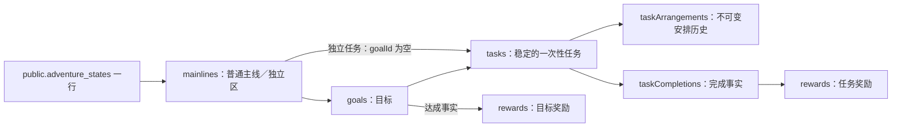

# 后端数据库设计

状态：2026-10-20 设计稿，供评审，暂不实现。沿用已确认的单账户聚合存储决策；以下结构与内部版本是设计选择，不是已执行的数据库变更，也不是最终 HTTP 契约。

**唯一物理表是 `public.adventure_states`。** 主线、目标、任务、执行安排、完成记录和奖励记录都是 `state` 这个 `jsonb` 对象中的嵌套逻辑记录，不创建六张物理表。逻辑关联不是 PostgreSQL 外键，逻辑类型也不是 PostgreSQL 列类型。

本期只包含主线、目标、一次性任务与成长奖励。业务规则见 [规格](spec.md)、[成长与奖励](growth-rewards.md)，处理流程见 [后端业务逻辑](backend-business-logic.md)，前端消费方式见 [前端设计](decisions-frontend.md)。

## 物理表定义

现有 DDL 位于 `db/adventure/create-state.sql`；本次不修改或执行 SQL。`public.adventure_states` 只有以下五个物理列：

| 列名 | PostgreSQL 类型 | 可空 | 默认值 | 约束与职责 |
|---|---|---|---|---|
| `owner_id` | `uuid` | 否 | 无 | 主键；每个账户一行，只能由服务端已验证身份取得 |
| `state` | `jsonb` | 否 | 无 | `jsonb_typeof(state) = 'object'`；保存业务事实及逻辑删除记录 |
| `journal` | `jsonb` | 否 | `'{}'::jsonb` | `jsonb_typeof(journal) = 'object'`；保存成功命令的摘要与稳定回执 |
| `version` | `bigint` | 否 | `0` | `0 <= version <= 9007199254740991`；成功业务写入递增，用于 CAS |
| `updated_at` | `timestamptz` | 否 | `now()` | 初始化默认当前时间；业务写入使用本次服务端权威时间 |

等效列结构如下。这里只复述设计基线，不表示本次重新执行 DDL：

```sql
create table public.adventure_states (
  owner_id uuid primary key,
  state jsonb not null check (jsonb_typeof(state) = 'object'),
  journal jsonb not null default '{}'::jsonb
    check (jsonb_typeof(journal) = 'object'),
  version bigint not null default 0
    check (version >= 0 and version <= 9007199254740991),
  updated_at timestamptz not null default now()
);
```

唯一物理索引是 `owner_id` 主键。本期按 `owner_id` 读取完整聚合，不增加 JSONB 搜索索引，也不把全部账户拉到 Worker 筛选。

这延续了已有存储取舍：一次写入容易保持全部事实原子一致，但会读写整个账户聚合，同一账户操作不同任务也可能产生版本冲突；不承诺无限历史容量或高并发写入吞吐。本期接受这一约束，不另拆物理表，后续实现须按真实数据规模验证。

## 权限与隔离

沿用现有权限：启用 RLS，撤回 PUBLIC、anon、authenticated 的表权限，不建立浏览器直连策略；service_role 仅 SELECT／INSERT／UPDATE，不授予 DELETE。该角色可绕过 RLS，所以 Worker 每次仍须在线验证身份并限定 `owner_id`；写入额外限定旧 `version`。`owner_id` 沿用无 `auth.users` 外键的约定，不在本期加入账户删除级联。

## JSONB 内部结构与逻辑关联

`state` 采用新的 `schemaVersion=2`，`timeZone` 固定 `Asia/Shanghai`；包含 `mainlines`、`goals`、`tasks`、`taskArrangements`、`taskCompletions`、`rewards` 六个数组。`journal` 与并发 `version` 仍为物理列，不嵌套复制到 `state`。



这些是 JSONB 内的逻辑关联，不新增 SQL 表、数据库外键或逐记录 SQL 唯一约束。ID 唯一性、引用完整性及业务条件由后端领域 Module 校验，并与 `state`、`journal`、`version` 在同一次单行 CAS 中原子保存。

### 通用逻辑类型

JSONB 不提供列级类型，以下术语表示后端对嵌套值的运行时约束：

| 逻辑类型 | 含义 |
|---|---|
| `uuid` | 服务端生成或验证的 UUID 字符串 |
| `date` | 真实存在的 `YYYY-MM-DD` 业务日期 |
| `timestamp` | 带时区的 UTC 时间字符串 |
| `text` | 普通字符串；未填写的说明或感想为空字符串 |
| `enum<T>` | 只允许列出的枚举字符串 |
| `safeInteger` | 安全整数；具体计数、金额或排序键为非负 |
| `uuid[]` | UUID 字符串数组，用于冻结的计奖完成 ID |
| `object` | 结构化嵌套对象，子字段在下文展开 |

逻辑 ID 使用 UUID 字符串。所有数组元素及逻辑记录 ID 在所属集合内唯一。字段除标注可空或仅特定类型／状态存在外均必填。输入长度上限在接口定义阶段统一确定。

## 六类嵌套逻辑记录

### `mainlines`：主线与独立区

每账户恰好一条 `kind = independent` 的独立区；普通主线 `kind = normal`，在用数量最多五条。

| 逻辑字段 | 逻辑类型 | 可空 | 约束与含义 |
|---|---|---|---|
| `id` | `uuid` | 否 | 集合内唯一，不随改名变化 |
| `kind` | `enum<normal, independent>` | 否 | 不用名称识别系统独立身份 |
| `name` | `text` | 否 | 当前名称 |
| `status` | `enum<active, ended>` | 否 | 独立区固定 `active`；普通主线只能手动结束 |
| `createdAt` | `timestamp` | 否 | 创建时间 |
| `updatedAt` | `timestamp` | 否 | 最近修改时间 |
| `endedAt` | `timestamp` | 是 | `ended` 时必须存在；`active` 时为空 |

### `goals`：目标

| 逻辑字段 | 逻辑类型 | 可空 | 约束与含义 |
|---|---|---|---|
| `id` | `uuid` | 否 | 集合内唯一，迁移不更换 |
| `mainlineId` | `uuid` | 否 | 引用 `mainlines.id`；创建／迁入只允许在用普通主线或独立区，终态目标保留原主线引用 |
| `title` | `text` | 否 | 当前名称 |
| `standard` | `text` | 否 | 当前完成标准 |
| `status` | `enum<active, achieved, ended>` | 否 | 后两者为不可恢复终态 |
| `focused` | `boolean` | 否 | 终态必须为 `false` |
| `order` | `safeInteger` | 否 | 归属内排序键，非负 |
| `createdAt` | `timestamp` | 否 | 创建时间 |
| `updatedAt` | `timestamp` | 否 | 最近修改时间 |
| `terminatedAt` | `timestamp` | 是 | 终态时必须存在，`active` 时为空 |
| `terminationCause` | `enum<achieved, ended, mainline_ended>` | 是 | 仅终态存在，记录终态来源类型 |
| `attainment` | `object` | 是 | 仅 `achieved` 存在，结构见下 |

`attainment` 子字段：

| 子字段 | 逻辑类型 | 可空 | 约束与含义 |
|---|---|---|---|
| `achievedAt` | `timestamp` | 否 | 目标达成时间 |
| `rewardId` | `uuid` | 否 | 引用同一目标对应的 `goal` 奖励 |

每个归属最多三个 `active` 且 `focused` 的目标，独立目标共用独立区三个名额。展示先聚焦、再按 `order`；同组排序只调整组内相对顺序。迁入使用目的归属末尾新键，保证落位目的同类组末尾且不改变其他目标相对顺序。

`achieved` 必须存在 `attainment` 和一份目标奖励；`active`／`ended` 不生成目标奖励。目标进入终态停止下属任务，但不能把已完成任务改成未完成或删除完成事实。

### `tasks`：稳定的一次性任务

| 逻辑字段 | 逻辑类型 | 可空 | 约束与含义 |
|---|---|---|---|
| `id` | `uuid` | 否 | 集合内唯一；同时作为一次性行动稳定身份 |
| `kind` | `enum<once>` | 否 | 本期固定 `once`，类型不可转换 |
| `goalId` | `uuid` | 是 | 非空引用 `goals.id`；为空表示直接归属唯一独立区 |
| `title` | `text` | 否 | 当前名称 |
| `description` | `text` | 否 | 当前说明，未填写为空字符串 |
| `status` | `enum<pending, completed, ended>` | 否 | 逾期不是存储状态 |
| `currentArrangementId` | `uuid` | 否 | 引用同一任务的 `taskArrangements.id` |
| `activeCompletionId` | `uuid` | 是 | `completed` 时必须引用唯一有效完成；`pending`／`ended` 时为空 |
| `createdAt` | `timestamp` | 否 | 创建时间 |
| `updatedAt` | `timestamp` | 否 | 最近修改时间 |
| `endedAt` | `timestamp` | 是 | `ended` 时必须存在，否则为空 |
| `endCause` | `enum<manual, goal_achieved, goal_ended, mainline_ended>` | 是 | 仅 `ended` 存在，记录停止来源 |
| `deletedAt` | `timestamp` | 是 | 仅误建删除存在；逻辑删除后不进入有效业务查询 |

任务生命周期与 `activeCompletionId` 是明确业务事实，必须与有效完成一致；这与禁止持久保存等级／成就派生状态不同。已完成任务不再改为 `ended`，上级终态使它只读但保留 `completed`。

### `taskArrangements`：执行安排历史

| 逻辑字段 | 逻辑类型 | 可空 | 约束与含义 |
|---|---|---|---|
| `id` | `uuid` | 否 | 集合内唯一 |
| `taskId` | `uuid` | 否 | 引用 `tasks.id` |
| `plannedDate` | `date` | 否 | 本次安排的执行日期 |
| `previousArrangementId` | `uuid` | 是 | 首次安排为空；改期引用同一任务前一次安排，不能成环 |
| `snapshot` | `object` | 否 | 安排形成时的任务及归属快照，结构见下 |
| `createdAt` | `timestamp` | 否 | 安排形成时间 |

`snapshot` 子字段：

| 子字段 | 逻辑类型 | 可空 | 约束与含义 |
|---|---|---|---|
| `title` | `text` | 否 | 安排形成时的任务名称 |
| `description` | `text` | 否 | 安排形成时的任务说明 |
| `mainlineId` | `uuid` | 否 | 安排形成时所属主线或独立区 |
| `mainlineName` | `text` | 否 | 安排形成时主线名称 |
| `mainlineKind` | `enum<normal, independent>` | 否 | 安排形成时主线类型 |
| `goalId` | `uuid` | 是 | 安排形成时所属目标；独立任务为空 |
| `goalTitle` | `text` | 是 | 安排形成时目标名称；独立任务为空 |
| `goalStandard` | `text` | 是 | 安排形成时完成标准；独立任务为空 |

安排一经生成，日期和快照不可改写。改期追加记录并切换 `currentArrangementId`；旧记录继续保留。每个未删除任务只有一个当前安排。任务 `ended` 后停止当前及未来执行权限，但不抹去原安排。修改任务当前名称、说明或迁移当前归属不改写已有安排快照；后续完成按完成时现状生成新的完成快照。

### `taskCompletions`：完成事实

| 逻辑字段 | 逻辑类型 | 可空 | 约束与含义 |
|---|---|---|---|
| `id` | `uuid` | 否 | 集合内唯一；取消具体完成 ID |
| `taskId` | `uuid` | 否 | 引用 `tasks.id`；同一任务最多一条未删除完成 |
| `arrangementId` | `uuid` | 否 | 引用完成时对应的 `taskArrangements.id` |
| `completedAt` | `timestamp` | 否 | 服务端完成时间 |
| `completedDate` | `date` | 否 | Asia/Shanghai 完成日期 |
| `snapshot` | `object` | 否 | 完成时的内容与归属事实，结构见下 |
| `deletedAt` | `timestamp` | 是 | 取消完成时设置，逻辑删除记录保留 |

`snapshot` 子字段：

| 子字段 | 逻辑类型 | 可空 | 约束与含义 |
|---|---|---|---|
| `taskId` | `uuid` | 否 | 完成时任务身份 |
| `title` | `text` | 否 | 完成时任务名称 |
| `description` | `text` | 否 | 完成时任务说明 |
| `mainlineId` | `uuid` | 否 | 完成时主线或独立区 |
| `mainlineName` | `text` | 否 | 完成时主线名称 |
| `mainlineKind` | `enum<normal, independent>` | 否 | 完成时主线类型 |
| `goalId` | `uuid` | 是 | 完成时所属目标；独立任务为空 |
| `goalTitle` | `text` | 是 | 完成时目标名称；独立任务为空 |
| `goalStandard` | `text` | 是 | 完成时完成标准；独立任务为空 |
| `plannedDate` | `date` | 否 | 完成时执行安排日期 |
| `previousArrangementId` | `uuid` | 是 | 完成时安排的来源引用，可空 |

同一 `taskId` 最多一条 `deletedAt` 为空的完成记录。`completed` 任务的 `activeCompletionId` 必须指向它。取消具体完成 ID，不能只按任务 ID 删除“当前看到的任意一次完成”；重新完成生成新完成 ID，原逻辑删除记录不复活。

独立任务快照的 `mainlineId` 指向独立区、`goalId` 为空。历史归属用于计奖和撤销锁定，当前迁移不能改写或绕过它；安排的旧归属不阻止迁出后当前任务的合法新完成。

### `rewards`：奖励事实

| 逻辑字段 | 逻辑类型 | 可空 | 约束与含义 |
|---|---|---|---|
| `id` | `uuid` | 否 | 集合内唯一 |
| `kind` | `enum<task, goal>` | 否 | 决定来源与计算结构 |
| `completionId` | `uuid` | 是 | 仅 `task` 存在，引用具体完成 |
| `goalId` | `uuid` | 是 | 仅 `goal` 存在，引用已达成目标 |
| `amount` | `safeInteger` | 否 | 正整数；任务固定 1，目标 N>0 时 N×C、N=0 时固定 1 |
| `awardedAt` | `timestamp` | 否 | 入账时间 |
| `awardedDate` | `date` | 否 | 入账规划日期 |
| `calculation` | `object` | 否 | 计奖依据，结构随 `kind` 变化 |
| `snapshot` | `object` | 是 | 仅 `goal` 存在；达成时名称、标准和归属快照 |
| `deletedAt` | `timestamp` | 是 | 取消任务完成时与对应任务奖励同时设置；目标奖励不可撤销 |

`completionId` 与 `goalId` 按 `kind` 互斥：`task` 奖励恰好一个 `completionId` 且 `goalId` 为空；`goal` 奖励恰好一个 `goalId` 且 `completionId` 为空。

`calculation` 子字段：

| 子字段 | 逻辑类型 | 可空 | 约束与含义 |
|---|---|---|---|
| `type` | `enum<fixed_task, goal_actions, goal_minimum>` | 否 | 任务固定、目标行动数乘系数或目标保底 |
| `countedCompletionIds` | `uuid[]` | 否 | `task` 奖励为空数组；目标奖励冻结参与计奖的完成 ID |
| `actionCount` | `safeInteger` | 否 | 去重行动数 N；任务为 0，目标可为 0 |
| `coefficient` | `enum<1, 2, 3>` | 否 | 任务固定 1；目标使用用户选择或默认 1 |
| `reflection` | `text` | 否 | 仅目标可用；未填写为空字符串 |

`snapshot` 子字段：

| 子字段 | 逻辑类型 | 可空 | 约束与含义 |
|---|---|---|---|
| `title` | `text` | 否 | 目标达成时名称 |
| `standard` | `text` | 否 | 目标达成时完成标准 |
| `mainlineId` | `uuid` | 否 | 目标达成时主线或独立区 |
| `mainlineName` | `text` | 否 | 目标达成时主线名称 |
| `mainlineKind` | `enum<normal, independent>` | 否 | 目标达成时主线类型 |

每条有效完成恰好一份有效 `task` 奖励，每个 `achieved` 目标恰好一份不可撤销的 `goal` 奖励。奖励的 `amount`、计奖依据、来源和完成记录必须相互一致；逻辑删除的奖励不参与总经验。

目标 N 根据完成时 `goalId` 选出当前有效完成，再按稳定 `taskId` 去重；不是当前挂载任务数。目标奖励冻结 `countedCompletionIds`、N、C 与计算类型，不因后续改名迁移重新解释。目标奖励不增加行动数。

## `journal` 内部结构

`journal` 的物理类型仍是 `jsonb`，键沿用 `request:<requestId>`。每条成功回执的逻辑结构如下：

| 逻辑字段 | 逻辑类型 | 可空 | 约束与含义 |
|---|---|---|---|
| `hash` | `text` | 否 | 规范化命令的 SHA-256 摘要 |
| `commandType` | `enum` | 否 | 与当前命令集合一致的命令类型 |
| `appliedVersion` | `safeInteger` | 否 | 成功写入后的聚合版本 |
| `appliedAt` | `timestamp` | 否 | 成功写入时间 |
| `entityIds` | `uuid[]` | 否 | 受影响对象标识，可为空数组 |
| `completionIds` | `uuid[]` | 否 | 受影响完成标识，可为空数组 |
| `rewardIds` | `uuid[]` | 否 | 受影响奖励标识，可为空数组 |

摘要按严格校验后的命令计算：对象键排序、数组顺序保留，不包含 `expectedVersion`。相同 owner／requestId 与摘要返回原回执；同 key 异命令拒绝。journal 与 state、version 同次 CAS 提交，失败命令不写成功回执，不自动裁剪旧 key。

不将 `levelBefore`、`levelAfter`、`achievementIds`、解锁标记或解锁日期保存进新 journal。响应中的等级、成就和操作前后反馈按对应版本实时投影；重复请求返回稳定事实回执与最新投影，不重新发奖。

## 完整 JSON 示例

下面是 `public.adventure_states` 一行的示意。仅保留验证结构所需的样例，不是完整业务数据，也不表示示例已写入数据库；实际 ID 应由服务端生成。

```json
{
  "owner_id": "10000000-0000-4000-8000-000000000001",
  "version": 7,
  "updated_at": "2026-10-20T04:30:00Z",
  "state": {
    "schemaVersion": 2,
    "timeZone": "Asia/Shanghai",
    "mainlines": [
      {
        "id": "20000000-0000-4000-8000-000000000001",
        "kind": "independent",
        "name": "独立区",
        "status": "active",
        "createdAt": "2026-10-20T01:00:00Z",
        "updatedAt": "2026-10-20T01:00:00Z",
        "endedAt": null
      },
      {
        "id": "20000000-0000-4000-8000-000000000002",
        "kind": "normal",
        "name": "健康与活力",
        "status": "active",
        "createdAt": "2026-10-20T01:01:00Z",
        "updatedAt": "2026-10-20T01:01:00Z",
        "endedAt": null
      }
    ],
    "goals": [
      {
        "id": "30000000-0000-4000-8000-000000000001",
        "mainlineId": "20000000-0000-4000-8000-000000000002",
        "title": "完成一次 10 公里越野",
        "standard": "在户外连续完成 10 公里路线，并记录一次体验。",
        "status": "active",
        "focused": true,
        "order": 0,
        "createdAt": "2026-10-20T01:02:00Z",
        "updatedAt": "2026-10-20T01:02:00Z",
        "terminatedAt": null,
        "terminationCause": null,
        "attainment": null
      }
    ],
    "tasks": [
      {
        "id": "40000000-0000-4000-8000-000000000001",
        "kind": "once",
        "goalId": "30000000-0000-4000-8000-000000000001",
        "title": "完成一次 5 公里适应跑",
        "description": "用舒服的节奏跑完，感受身体的状态。",
        "status": "completed",
        "currentArrangementId": "50000000-0000-4000-8000-000000000001",
        "activeCompletionId": "60000000-0000-4000-8000-000000000001",
        "createdAt": "2026-10-20T01:03:00Z",
        "updatedAt": "2026-10-20T04:20:00Z",
        "endedAt": null,
        "endCause": null,
        "deletedAt": null
      },
      {
        "id": "40000000-0000-4000-8000-000000000002",
        "kind": "once",
        "goalId": null,
        "title": "取回修好的耳机",
        "description": "",
        "status": "pending",
        "currentArrangementId": "50000000-0000-4000-8000-000000000002",
        "activeCompletionId": null,
        "createdAt": "2026-10-20T01:04:00Z",
        "updatedAt": "2026-10-20T01:04:00Z",
        "endedAt": null,
        "endCause": null,
        "deletedAt": null
      }
    ],
    "taskArrangements": [
      {
        "id": "50000000-0000-4000-8000-000000000001",
        "taskId": "40000000-0000-4000-8000-000000000001",
        "plannedDate": "2026-10-20",
        "previousArrangementId": null,
        "snapshot": {
          "title": "完成一次 5 公里适应跑",
          "description": "用舒服的节奏跑完，感受身体的状态。",
          "mainlineId": "20000000-0000-4000-8000-000000000002",
          "mainlineName": "健康与活力",
          "mainlineKind": "normal",
          "goalId": "30000000-0000-4000-8000-000000000001",
          "goalTitle": "完成一次 10 公里越野",
          "goalStandard": "在户外连续完成 10 公里路线，并记录一次体验。"
        },
        "createdAt": "2026-10-20T01:03:00Z"
      },
      {
        "id": "50000000-0000-4000-8000-000000000002",
        "taskId": "40000000-0000-4000-8000-000000000002",
        "plannedDate": "2026-10-20",
        "previousArrangementId": null,
        "snapshot": {
          "title": "取回修好的耳机",
          "description": "",
          "mainlineId": "20000000-0000-4000-8000-000000000001",
          "mainlineName": "独立区",
          "mainlineKind": "independent",
          "goalId": null,
          "goalTitle": null,
          "goalStandard": null
        },
        "createdAt": "2026-10-20T01:04:00Z"
      }
    ],
    "taskCompletions": [
      {
        "id": "60000000-0000-4000-8000-000000000001",
        "taskId": "40000000-0000-4000-8000-000000000001",
        "arrangementId": "50000000-0000-4000-8000-000000000001",
        "completedAt": "2026-10-20T04:20:00Z",
        "completedDate": "2026-10-20",
        "snapshot": {
          "taskId": "40000000-0000-4000-8000-000000000001",
          "title": "完成一次 5 公里适应跑",
          "description": "用舒服的节奏跑完，感受身体的状态。",
          "mainlineId": "20000000-0000-4000-8000-000000000002",
          "mainlineName": "健康与活力",
          "mainlineKind": "normal",
          "goalId": "30000000-0000-4000-8000-000000000001",
          "goalTitle": "完成一次 10 公里越野",
          "goalStandard": "在户外连续完成 10 公里路线，并记录一次体验。",
          "plannedDate": "2026-10-20",
          "previousArrangementId": null
        },
        "deletedAt": null
      }
    ],
    "rewards": [
      {
        "id": "70000000-0000-4000-8000-000000000001",
        "kind": "task",
        "completionId": "60000000-0000-4000-8000-000000000001",
        "goalId": null,
        "amount": 1,
        "awardedAt": "2026-10-20T04:20:00Z",
        "awardedDate": "2026-10-20",
        "calculation": {
          "type": "fixed_task",
          "countedCompletionIds": [],
          "actionCount": 0,
          "coefficient": 1,
          "reflection": ""
        },
        "snapshot": null,
        "deletedAt": null
      }
    ]
  },
  "journal": {
    "request:demo-complete-01": {
      "hash": "0123456789abcdef0123456789abcdef0123456789abcdef0123456789abcdef",
      "commandType": "completeTask",
      "appliedVersion": 7,
      "appliedAt": "2026-10-20T04:20:00Z",
      "entityIds": ["40000000-0000-4000-8000-000000000001"],
      "completionIds": ["60000000-0000-4000-8000-000000000001"],
      "rewardIds": ["70000000-0000-4000-8000-000000000001"]
    }
  }
}
```

## 一致性与容量

- 所有引用必须落在同一 owner 聚合内；ID 唯一，删除任务仍保留原记录，不能出现悬空安排、完成或奖励。
- 主线／目标／任务终态传播、聚焦名额、完成唯一性、奖励对应关系和历史锁定在同一次领域命令中校验并提交。物理数据库只保证行主键、列约束及原子行更新，不能把 JSONB 内部不变量误称为数据库外键或唯一约束。
- 账户总经验、等级、本级经验进度、七个成就、成就满足状态、解锁日期及操作能力不持久保存；读取／预览／成功操作后从同一版本有效事实计算，前端只消费结果。
- 按完整候选行的紧凑 UTF-8 序列化大小限制 8,000,000 bytes，包含 `state`、`journal`、`owner_id`、`version`、`updated_at`；这不是 PostgreSQL 实际存储字节上限。超限拒绝写入，原数据继续可读，不裁剪历史、逻辑删除记录或幂等事实。现有 32 MB 上游读取上限继续有效。
- 本期不增加周期、检查清单、计划结束日期、成就表、等级表或额外增长状态。账户无记录时初始化空业务集合及唯一独立区，不导入原型样例。
- 现有代码是 `schemaVersion=1`，含周期、持久化成就和旧结算字段，不能冒称已符合本设计。新设计用 `schemaVersion=2`；旧结构遇到新读写器应明确拒绝或采用单独核准的转换，不能静默覆盖、清空或用空状态替换。模块无线上用户历史，本设计不以旧版历史迁移为开发前置，本次不处理任何验收数据。

## 依据

- 项目现有 DDL：`db/adventure/create-state.sql`；存储 Adapter：`worker/adventure/store.ts`；存储决策：[ADR 0002](../adr/0002-adventure-owner-state.md)。
- [PostgreSQL JSON 类型](https://www.postgresql.org/docs/current/datatype-json.html)：JSONB 的结构能力不等于业务引用约束。
- [Supabase RLS](https://supabase.com/docs/guides/database/postgres/row-level-security)：权限及服务端角色访问边界。
- [PostgREST 事务](https://docs.postgrest.org/en/stable/references/transactions.html)：请求事务及提交行为。

本次只核对本地结构及官方资料，没有连接真实业务数据库、执行 SQL、生成迁移或修改权限。真实实例仍须在后续实现验收中核对，不能从本文件推断线上结构已更新。
