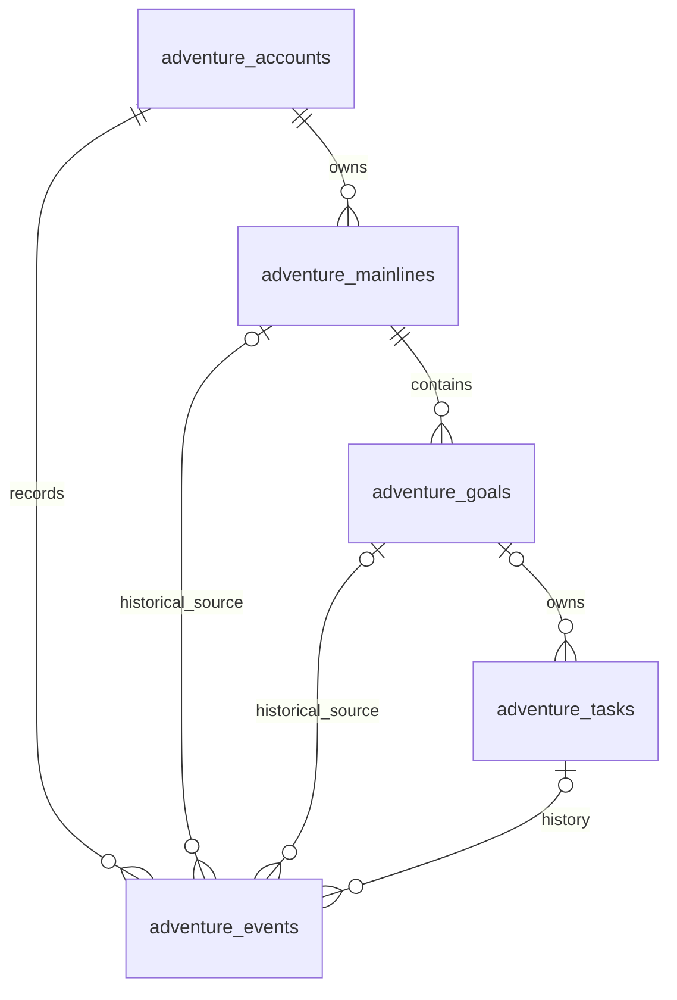

# 后端数据库设计

状态：2026-10-20 五表及 #54 创建／编辑事务已实现；其他业务命令仍按任务依赖实施。空库初始化统一使用 `db/adventure/create-planning.sql`；不保留未上线阶段的重复升级链，本轮不操作现有数据库或验收数据。当前接口见 [主线与目标接口](planning-api.md)。

五表设计保留当前业务对象的独立身份和数据库关联，不为历史安排、完成、奖励和请求回执分别建表。等级、本级进度、七个成就和操作能力仍实时计算，不单独建表。完整业务规则见 [规格](spec.md) 和 [成长与奖励](growth-rewards.md)，事务与命令见 [后端业务逻辑](backend-business-logic.md)。

## 物理表总览

所有表位于 public schema，使用 adventure_ 前缀，与首页共享 tasks／schedules 分开。

| 表名 | 职责 |
|---|---|
| `public.adventure_accounts` | 账户汇总经验、并发版本、时区和更新时间 |
| `public.adventure_mainlines` | 普通主线及系统独立主线 |
| `public.adventure_goals` | 真实目标及隐藏的系统收纳目标 |
| `public.adventure_tasks` | 一次性任务当前内容、当前执行日期、归属和生命周期 |
| `public.adventure_events` | 操作历史、完成与取消、奖励、快照、计奖依据及请求幂等回执 |



所有子表都有非空 owner_id 引用 adventure_accounts。goal.mainline_id、task.goal_id 及 event 的历史来源使用真实列；跨表引用采用包含 owner_id 的复合外键，不能只靠全局 UUID 或查询过滤防串账户。

## 账户、汇总与事件事实

`adventure_accounts.total_xp` 是当前有效奖励之和的账户汇总，用于快速展示总经验；等级、本级进度、距升级经验、行动数、达成目标数和七个成就仍从事实实时计算。

每次成功写入必须同事务维护 `total_xp` 与事件：任务完成写入完成和 +1 奖励事件并加总；取消完成把原完成和对应奖励事件标记失效并减总；目标达成写入达成和奖励事件并加总。任意时刻都应满足：

> total_xp = 未失效、属于奖励类型的事件 amount 之和

这条等式由事务 Module 校验。事件日志仍是可追溯事实来源，账户汇总不是另一套独立账本；不能先改总经验再异步补事件，也不能只写事件不更新汇总。读取可用汇总展示总值，仍须按事件类型和失效标记实时计算等级、成就与流水。

事件同时承担幂等回执：成功的 request_id 及其命令摘要保存在 event 记录中，即使对应完成或奖励后来逻辑失效也不能物理删除。重试先查全部历史事件，避免已取消的完成被旧请求再次发放。若一个命令新增多条事件（如完成＋奖励），只有首条携带成功回执，其他事件以同一 event_group_id 关联；重试按首条回执返回，不能让分组内每条都触发一次业务回执。

## 字段定义

下表为真实 PostgreSQL 列，不是 JSON 逻辑类型。状态暂用 text＋CHECK，不新增数据库枚举。除特别标注外字段不可空。时间点用 timestamptz，业务日期用 date，统一由后端按 Asia/Shanghai 解释；名称、说明、标准为普通文本，长度在接口阶段映射。

写命令取得账户行锁后只捕获一次 clock_timestamp()，写入本次事件和更新字段的同一时间，避免锁等待跨日时把 now() 与业务日期混用。列默认 now() 不替代此规则。

### `public.adventure_accounts`

| 字段 | PostgreSQL 类型 | 可空 | 默认值 | 约束与含义 |
|---|---|---|---|---|
| `owner_id` | `uuid` | 否 | 无 | 主键；Worker 在线验证身份取得，不接受客户端传入 |
| `total_xp` | `bigint` | 否 | `0` | 非负安全整数；当前有效奖励事件 amount 之和 |
| `revision` | `bigint` | 否 | `0` | 0..9007199254740991；每次成功命令加一 |
| `time_zone` | `text` | 否 | `'Asia/Shanghai'` | CHECK 固定为 Asia/Shanghai |
| `created_at` | `timestamptz` | 否 | `now()` | 账户行创建时间 |
| `updated_at` | `timestamptz` | 否 | `now()` | 每次成功业务命令显式更新 |

账户由首次读取或首次写入安全初始化，不导入原型数据。`total_xp` 不可由客户端直接更新；取消完成的扣减和目标奖励的增加都走事务命令。

### `public.adventure_mainlines`

| 字段 | PostgreSQL 类型 | 可空 | 默认值 | 约束与含义 |
|---|---|---|---|---|
| `id` | `uuid` | 否 | `gen_random_uuid()` | 主键；稳定 ID |
| `owner_id` | `uuid` | 否 | 无 | 引用 adventure_accounts.owner_id |
| `kind` | `text` | 否 | 无 | CHECK IN ('normal','independent') |
| `name` | `varchar(200)` | 否 | 无 | 非空当前名称 |
| `status` | `text` | 否 | `'active'` | CHECK IN ('active','ended') |
| `created_at` | `timestamptz` | 否 | `now()` | 创建时间 |
| `updated_at` | `timestamptz` | 否 | `now()` | 最近修改时间 |
| `ended_at` | `timestamptz` | 是 | `NULL` | ended 时非空，active 时为空 |

普通主线 kind=normal，最多五条 active；只能手动结束。系统独立主线 kind=independent，不占五条名额、不能结束，页面不显示为普通主线容器。独立主线在首次创建独立目标或独立任务时按需建立，之后复用；不是每账户初始化时预先写入。

### `public.adventure_goals`

| 字段 | PostgreSQL 类型 | 可空 | 默认值 | 约束与含义 |
|---|---|---|---|---|
| `id` | `uuid` | 否 | `gen_random_uuid()` | 主键；稳定 ID |
| `owner_id` | `uuid` | 否 | 无 | 引用 adventure_accounts.owner_id |
| `mainline_id` | `uuid` | 否 | 无 | 同 owner 主线引用 |
| `kind` | `text` | 否 | `'real'` | CHECK IN ('real','inbox') |
| `title` | `varchar(200)` | 否 | 无 | 当前名称；真实目标必填，inbox 使用固定系统名称 |
| `standards` | `jsonb` | 否 | 无 | 当前完成标准数组，1–50 项、每项非空且最多 4,000 字；inbox 使用固定系统说明 |
| `status` | `text` | 否 | `'active'` | CHECK IN ('active','achieved','ended') |
| `focused` | `boolean` | 否 | `false` | 仅 real 可为 true；inbox 永 false |
| `sort_order` | `bigint` | 否 | `0` | 非负安全整数；同归属 real 目标排序 |
| `created_at` | `timestamptz` | 否 | `now()` | 创建时间 |
| `updated_at` | `timestamptz` | 否 | `now()` | 最近修改时间 |
| `terminated_at` | `timestamptz` | 是 | `NULL` | 真实目标终态时非空 |
| `termination_cause` | `text` | 是 | `NULL` | achieved／ended／mainline_ended |
| `achieved_at` | `timestamptz` | 是 | `NULL` | 仅 achieved 的 real 目标存在 |
| `achieved_on` | `date` | 是 | `NULL` | 达成规划日期，仅 achieved 存在 |
| `attainment_coefficient` | `smallint` | 是 | `NULL` | 1..3；仅 achieved 的 real 目标存在 |
| `attainment_reflection` | `text` | 是 | `NULL` | 可选感想；未填为空字符串 |
| `attainment_action_count` | `integer` | 是 | `NULL` | 非负；目标奖励计奖行动数 |
| `attainment_action_ids` | `uuid[]` | 是 | `NULL` | 冻结的有效行动 ID；按稳定 taskId 去重 |
| `attainment_snapshot` | `jsonb` | 是 | `NULL` | CHECK 根 object；目标名称、标准、主线名及类型 |

真实目标 kind=real 的名称和完成标准必填，可编辑、聚焦、迁移、达成或结束。系统收纳目标 kind=inbox 固定为独立主线下的 active 系统记录，不展示、不聚焦、不计目标数量、目标成就或目标奖励，不能编辑、结束、迁移或删除，仅承接不依附真实目标的独立任务。每个账户最多一条 inbox，按需创建并复用。

达成信息直接存于真实目标行，不另建 attainment 表；`attainment_action_ids` 冻结计奖行动，`attainment_action_count` 与其去重数量一致。inbox 的达成字段必须全空。真实目标迁移只更新 mainline_id，历史事件快照不改；mainline_id 可引用已结束主线以保留终态目标历史。

### `public.adventure_tasks`

| 字段 | PostgreSQL 类型 | 可空 | 默认值 | 约束与含义 |
|---|---|---|---|---|
| `id` | `uuid` | 否 | `gen_random_uuid()` | 主键；稳定任务／行动身份，改期不换 |
| `owner_id` | `uuid` | 否 | 无 | 引用 adventure_accounts.owner_id |
| `goal_id` | `uuid` | 否 | 无 | 同 owner 目标；独立任务引用 inbox 目标 |
| `kind` | `text` | 否 | `'once'` | CHECK kind='once'；本期不可转换 |
| `title` | `varchar(200)` | 否 | 无 | 当前名称 |
| `description` | `text` | 否 | `''` | 可选说明 |
| `planned_on` | `date` | 否 | 无 | 当前执行日期；改期更新，原日期保存在 event |
| `status` | `text` | 否 | `'pending'` | CHECK IN ('pending','completed','ended') |
| `completed_at` | `timestamptz` | 是 | `NULL` | completed 时非空，否则为空 |
| `completed_on` | `date` | 是 | `NULL` | 当前有效完成日期 |
| `ended_at` | `timestamptz` | 是 | `NULL` | ended 时非空，否则为空 |
| `end_cause` | `text` | 是 | `NULL` | manual／goal_achieved／goal_ended／mainline_ended |
| `deleted_at` | `timestamptz` | 是 | `NULL` | 仅误建删除；逻辑隐藏，不物理删除 |
| `created_at` | `timestamptz` | 否 | `now()` | 创建时间 |
| `updated_at` | `timestamptz` | 否 | `now()` | 最近修改时间 |

任务表只保存当前 planned_on，不保存安排历史表。每次创建或改期都写一条 event，记录原日期、新日期及当时内容／归属快照。任务只保留一个稳定 id，改期不生成第二个任务或行动。

独立任务仍必须引用一个目标行，实际引用同账户唯一 inbox 目标；接口和页面把其展示为“独立任务”，不把它当作真实目标。真实目标下的任务迁移为独立任务时，只切换 goal_id 到 inbox，task id、当前日期和当前状态保留；历史 event 的 goal_id 与快照不改。

`completed_at`、`completed_on` 与 status 一致；取消完成把状态恢复 pending，并在同一事务清除当前完成时间、逻辑失效完成／奖励事件。旧事件仍保留，因此不把 completed 字段当成可追溯历史。

### `public.adventure_events`

| 字段 | PostgreSQL 类型 | 可空 | 默认值 | 约束与含义 |
|---|---|---|---|---|
| `id` | `uuid` | 否 | `gen_random_uuid()` | 主键 |
| `owner_id` | `uuid` | 否 | 无 | 引用 adventure_accounts.owner_id |
| `event_group_id` | `uuid` | 否 | 无 | 同一次成功命令的事件组；多事件事务共用 |
| `kind` | `text` | 否 | 无 | CHECK：task_created／task_updated／task_rescheduled／task_migrated／task_ended／task_deleted／task_completed／task_completion_cancelled／goal_created／goal_updated／goal_focused／goal_reordered／goal_migrated／goal_achieved／goal_ended／mainline_created／mainline_updated／mainline_ended／reward_task／reward_goal |
| `entity_type` | `text` | 否 | 无 | CHECK IN ('account','mainline','goal','task') |
| `entity_id` | `uuid` | 是 | `NULL` | 相关当前对象；账户级回执可为空 |
| `task_id` | `uuid` | 是 | `NULL` | 任务类事件引用稳定 task；不是任务事件为空 |
| `mainline_id` | `uuid` | 是 | `NULL` | 发生时主线／独立主线 |
| `goal_id` | `uuid` | 是 | `NULL` | 发生时目标，独立任务可为 inbox 目标 |
| `occurred_at` | `timestamptz` | 否 | `now()` | 事务内权威时间 |
| `occurred_on` | `date` | 否 | 无 | Asia/Shanghai 业务日期 |
| `actor_owner_id` | `uuid` | 否 | 无 | 与 owner_id 一致；保留事实列 |
| `request_id` | `varchar(128)` | 是 | `NULL` | 成功命令请求 ID；仅事件组首条非空，幂等索引用 |
| `command_hash` | `varchar(64)` | 是 | `NULL` | 规范化命令 SHA-256；与 request_id 成对 |
| `command_type` | `text` | 是 | `NULL` | 受支持命令类型；仅事件组首条非空 |
| `applied_revision` | `bigint` | 是 | `NULL` | 成功命令后的账户 revision；仅事件组首条非空 |
| `amount` | `bigint` | 是 | `NULL` | 仅 reward 事件；正安全整数 |
| `reward_task_id` | `uuid` | 是 | `NULL` | reward_task 对应 task |
| `reward_goal_id` | `uuid` | 是 | `NULL` | reward_goal 对应真实目标 |
| `calculation` | `jsonb` | 是 | `NULL` | 仅奖励；CHECK 根 object；冻结 N、C、计奖 ID 或固定 1 点依据 |
| `snapshot` | `jsonb` | 是 | `NULL` | 业务历史；CHECK 根 object；名称、说明、标准、原日期、原归属 |
| `invalidated_at` | `timestamptz` | 是 | `NULL` | 取消完成／奖励时逻辑失效；非奖励事件通常为空 |
| `invalidated_by_event_id` | `uuid` | 是 | `NULL` | 取消事件的稳定追溯 |
| `created_at` | `timestamptz` | 否 | `now()` | 事件写入时间 |

task_updated 记录待完成任务名称／说明编辑的前后内容和发生时归属，不覆盖已有历史快照；与当前任务、revision 和成功回执同事务提交。

事件表既是业务历史与奖励来源，也是成功命令的幂等回执。奖励事件不另建表：`kind=reward_task` 或 `reward_goal`，amount 和 calculation 冻结来源；完成事实由 task_completed 事件承载，取消完成由 task_completion_cancelled 事件和 invalidated_at 标记共同表达。

reward_task 的 reward_task_id 必须对应一个有效 task_completed 事件（通过事件快照或关联字段）；同一完成事件最多一个未失效 reward_task，取消完成同时失效两者。reward_goal 对应真实目标 goal_achieved 事件，冻结 attainment_action_ids、N、C 与 amount；取消完成不能撤销目标奖励。

请求去重字段只出现在每次成功命令的事件组首条，`request_id` 与 command_hash 成对；成功重试先按 request_id 查事件历史，再以 event_group_id 取回同组事件。幂等查询必须包含已失效事件，防止已取消完成被旧 key 重新发奖；不能按事件 kind 或 invalidated_at 过滤掉旧请求。

## 外键、唯一性与检查

以下约束已随五表迁移建立；未交付命令的跨行业务校验仍须随对应任务实施。主键之外增加必要的同 owner 复合唯一键，供子表复合外键使用。

| 表／约束 | 数据库保证 |
|---|---|
| mainlines UNIQUE(owner_id,id) | 账户内主线 ID 稳定 |
| goals UNIQUE(owner_id,id) 及 (owner_id,mainline_id) 外键 | 目标归属同账户主线 |
| goals(owner_id,mainline_id,kind) WHERE kind='inbox' 部分唯一 | 每个独立主线最多一条系统收纳目标 |
| tasks UNIQUE(owner_id,id) 及 (owner_id,goal_id) 外键 | 任务归属同账户目标 |
| tasks(owner_id,goal_id,status) 普通索引 | 目标下当前任务查询；不是唯一约束 |
| events UNIQUE(owner_id,request_id) WHERE request_id IS NOT NULL | 同一账户成功请求 ID 唯一 |
| events(owner_id,id) 及引用复合外键 | 事件历史来源限定同账户 |
| events(owner_id,task_id) 普通索引 | 任务完成、改期及取消追溯 |
| events(owner_id,kind,occurred_at,id) 普通索引 | 有效奖励与成长流水读取 |

独立主线部分唯一：mainlines(owner_id) WHERE kind='independent'。inbox 部分唯一：goals(owner_id) WHERE kind='inbox'。两者都在首次需要时创建；并发首次创建由唯一索引和事务重试合并为一条，不能靠名称判断。

行级 CHECK 覆盖枚举、状态时间一致性、金额为正、total_xp 非负、计数与 revision 安全整数范围、inbox 的 focused=false 且无达成字段、任务 completed 时 completed_at／completed_on 非空。事件与任务、目标、主线的跨行事实完整性必须由事务 Module 校验，不能写成跨表 CHECK。

由于任务只存当前 planned_on，改期历史通过 event 的 snapshot 和 occurred_at 追溯；events 的 task_id 指向当前稳定任务，不另建安排外键。取消完成必须使用 task_completion_cancelled 精确指向原 task_completed 事件，不能按 task_id 任意失效“当前”完成。events(owner_id,event_group_id,id) 普通索引用于按命令组追溯。

## 事务、权限与版本

多表写入必须通过后端专用数据库事务 RPC，不能把多次 PostgREST 独立请求拼成业务事务。建议的入口语义：

1. Worker 在线验证身份，得到 owner，严格校验命令封套；浏览器不得直接调用表或事务函数。
2. 事务以原子 upsert 初始化 accounts，并按需创建独立主线和 inbox；不覆盖已有账户内容。首次读取只初始化账户，不预建独立区。
3. 写入事务对 accounts 当前 owner 行 FOR UPDATE，之后查 events 的 request_id／command_hash 并核对 expectedVersion 与 revision；保持账户级锁顺序，不逐表独立提交。
4. 事务内校验当前主线、目标、任务、终态、聚焦、日期、历史锁定和具体输入，写入任务当前字段、事件历史／奖励、账户 total_xp、revision 及 updated_at。
5. 回执事件与业务事实同一提交；失败全部回滚。网络超时结果未知时原 request_id 重试，不能另建请求重复发奖。所有业务事件和 reward 事件共享 event_group_id，只有首条写入 request_id／command_hash／command_type／applied_revision。

所有表启用 RLS，撤回 PUBLIC／anon／authenticated 直接权限，不建立浏览器策略；后端角色仅获必需 SELECT／INSERT／UPDATE，不授予物理 DELETE。事务函数 SECURITY INVOKER，固定 search_path，显式撤回浏览器 EXECUTE，仅 Worker 后端角色可调用。角色权限不替代 owner 过滤与复合外键。

保留账户级 expectedVersion，不因五表而改为逐任务独立写入；同账户不同操作仍可能版本冲突。读取／预览使用短事务对账户行 FOR SHARE，再查主线、目标、任务和事件，保证一次响应的 revision、统计与能力一致；该内部入口必须是允许行锁的可读写 POST RPC，不能配置为 READ ONLY／STABLE GET。事务不等待用户确认、不调用外部服务，超时或锁等待超限整笔拒绝，不能只保存部分终态。

## 样例 JSON（按五张表分组）

以下为同一虚构账户的行集合，不是 HTTP 响应，也不是已经写入数据库的数据。列值均按上表字段；样例展示真实目标达成、独立任务、任务完成、奖励事件及成功回执。任务当前状态仅保留当前日期，改期原日期在 event 快照中。

```json
{
  "public.adventure_accounts": [
    {
      "owner_id": "10000000-0000-4000-8000-000000000001",
      "total_xp": 3,
      "revision": 9,
      "time_zone": "Asia/Shanghai",
      "created_at": "2026-10-20T01:00:00Z",
      "updated_at": "2026-10-20T04:30:00Z"
    }
  ],
  "public.adventure_mainlines": [
    {
      "id": "20000000-0000-4000-8000-000000000001",
      "owner_id": "10000000-0000-4000-8000-000000000001",
      "kind": "normal",
      "name": "健康与活力",
      "status": "active",
      "created_at": "2026-10-20T01:00:00Z",
      "updated_at": "2026-10-20T01:00:00Z",
      "ended_at": null
    },
    {
      "id": "20000000-0000-4000-8000-000000000002",
      "owner_id": "10000000-0000-4000-8000-000000000001",
      "kind": "independent",
      "name": "独立区",
      "status": "active",
      "created_at": "2026-10-20T01:00:00Z",
      "updated_at": "2026-10-20T01:00:00Z",
      "ended_at": null
    }
  ],
  "public.adventure_goals": [
    {
      "id": "30000000-0000-4000-8000-000000000002",
      "owner_id": "10000000-0000-4000-8000-000000000001",
      "mainline_id": "20000000-0000-4000-8000-000000000001",
      "kind": "real",
      "title": "完成一次 10 公里越野",
      "standards": ["在户外连续完成 10 公里路线，并记录一次体验。"],
      "status": "achieved",
      "focused": false,
      "sort_order": 0,
      "created_at": "2026-10-20T01:00:00Z",
      "updated_at": "2026-10-20T04:30:00Z",
      "terminated_at": "2026-10-20T04:30:00Z",
      "termination_cause": "achieved",
      "achieved_at": "2026-10-20T04:30:00Z",
      "achieved_on": "2026-10-20",
      "attainment_coefficient": 2,
      "attainment_reflection": "一步一步完成了。",
      "attainment_action_count": 1,
      "attainment_action_ids": [
        "40000000-0000-4000-8000-000000000001"
      ],
      "attainment_snapshot": {
        "title": "完成一次 10 公里越野",
        "standards": ["在户外连续完成 10 公里路线，并记录一次体验。"],
        "mainlineName": "健康与活力",
        "mainlineKind": "normal"
      }
    },
    {
      "id": "30000000-0000-4000-8000-000000000001",
      "owner_id": "10000000-0000-4000-8000-000000000001",
      "mainline_id": "20000000-0000-4000-8000-000000000002",
      "kind": "inbox",
      "title": "独立任务",
      "standards": ["系统收纳目标，仅承接不依附具体目标的独立任务。"],
      "status": "active",
      "focused": false,
      "sort_order": 0,
      "created_at": "2026-10-20T01:00:00Z",
      "updated_at": "2026-10-20T01:00:00Z",
      "terminated_at": null,
      "termination_cause": null,
      "achieved_at": null,
      "achieved_on": null,
      "attainment_coefficient": null,
      "attainment_reflection": null,
      "attainment_action_count": null,
      "attainment_action_ids": null,
      "attainment_snapshot": null
    }
  ],
  "public.adventure_tasks": [
    {
      "id": "40000000-0000-4000-8000-000000000001",
      "owner_id": "10000000-0000-4000-8000-000000000001",
      "goal_id": "30000000-0000-4000-8000-000000000001",
      "kind": "once",
      "title": "取回修好的耳机",
      "description": "",
      "planned_on": "2026-10-20",
      "status": "completed",
      "completed_at": "2026-10-20T04:20:00Z",
      "completed_on": "2026-10-20",
      "ended_at": null,
      "end_cause": null,
      "deleted_at": null,
      "created_at": "2026-10-20T01:00:00Z",
      "updated_at": "2026-10-20T04:20:00Z"
    }
  ],
  "public.adventure_events": [
    {
      "id": "50000000-0000-4000-8000-000000000001",
      "owner_id": "10000000-0000-4000-8000-000000000001",
      "kind": "task_completed",
      "entity_type": "task",
      "entity_id": "40000000-0000-4000-8000-000000000001",
      "task_id": "40000000-0000-4000-8000-000000000001",
      "mainline_id": "20000000-0000-4000-8000-000000000002",
      "goal_id": "30000000-0000-4000-8000-000000000001",
      "occurred_at": "2026-10-20T04:20:00Z",
      "occurred_on": "2026-10-20",
      "actor_owner_id": "10000000-0000-4000-8000-000000000001",
      "request_id": "demo-complete-task-01",
      "command_hash": "aaaaaaaaaaaaaaaaaaaaaaaaaaaaaaaaaaaaaaaaaaaaaaaaaaaaaaaaaaaaaaaa",
      "command_type": "completeTask",
      "applied_revision": 8,
      "amount": null,
      "reward_task_id": null,
      "reward_goal_id": null,
      "calculation": null,
      "snapshot": {
        "title": "取回修好的耳机",
        "description": "",
        "mainlineName": "独立区",
        "mainlineKind": "independent",
        "goalTitle": "独立任务",
        "goalStandard": "系统收纳目标，仅承接不依附具体目标的独立任务。"
      },
      "invalidated_at": null,
      "invalidated_by_event_id": null,
      "created_at": "2026-10-20T04:20:00Z"
    },
    {
      "id": "50000000-0000-4000-8000-000000000002",
      "owner_id": "10000000-0000-4000-8000-000000000001",
      "kind": "reward_task",
      "entity_type": "task",
      "entity_id": "40000000-0000-4000-8000-000000000001",
      "task_id": "40000000-0000-4000-8000-000000000001",
      "mainline_id": "20000000-0000-4000-8000-000000000002",
      "goal_id": "30000000-0000-4000-8000-000000000001",
      "occurred_at": "2026-10-20T04:20:00Z",
      "occurred_on": "2026-10-20",
      "actor_owner_id": "10000000-0000-4000-8000-000000000001",
      "request_id": null,
      "command_hash": null,
      "command_type": null,
      "applied_revision": null,
      "amount": 1,
      "reward_task_id": "40000000-0000-4000-8000-000000000001",
      "reward_goal_id": null,
      "calculation": {
        "type": "fixed_task",
        "count": 1,
        "coefficient": 1
      },
      "snapshot": {
        "title": "取回修好的耳机",
        "description": "",
        "mainlineName": "独立区",
        "mainlineKind": "independent",
        "goalTitle": "独立任务",
        "goalStandard": "系统收纳目标，仅承接不依附具体目标的独立任务。"
      },
      "invalidated_at": null,
      "invalidated_by_event_id": null,
      "created_at": "2026-10-20T04:20:00Z"
    },
    {
      "id": "50000000-0000-4000-8000-000000000003",
      "owner_id": "10000000-0000-4000-8000-000000000001",
      "kind": "reward_goal",
      "entity_type": "goal",
      "entity_id": "30000000-0000-4000-8000-000000000002",
      "task_id": null,
      "mainline_id": "20000000-0000-4000-8000-000000000001",
      "goal_id": "30000000-0000-4000-8000-000000000002",
      "occurred_at": "2026-10-20T04:30:00Z",
      "occurred_on": "2026-10-20",
      "actor_owner_id": "10000000-0000-4000-8000-000000000001",
      "request_id": "demo-complete-goal-01",
      "command_hash": "bbbbbbbbbbbbbbbbbbbbbbbbbbbbbbbbbbbbbbbbbbbbbbbbbbbbbbbbbbbbbbbb",
      "command_type": "completeGoal",
      "applied_revision": 9,
      "amount": 2,
      "reward_task_id": null,
      "reward_goal_id": "30000000-0000-4000-8000-000000000002",
      "calculation": {
        "type": "goal_actions",
        "actionCount": 1,
        "coefficient": 2,
        "actionIds": [
          "40000000-0000-4000-8000-000000000001"
        ]
      },
      "snapshot": {
        "title": "完成一次 10 公里越野",
        "standards": ["在户外连续完成 10 公里路线，并记录一次体验。"],
        "mainlineName": "健康与活力",
        "mainlineKind": "normal"
      },
      "invalidated_at": null,
      "invalidated_by_event_id": null,
      "created_at": "2026-10-20T04:30:00Z"
    }
  ]
}
```


样例中的 `total_xp=3` 等于未失效 reward_task（1）与 reward_goal（2）事件之和；任务 completed、完成时间、目标 achieved 和达成字段分别与事件事实对应。若取消该完成，必须写入 task_completion_cancelled 事件并失效完成／reward_task，同时把账户 total_xp 从 3 调整为 2；目标 reward_goal 不可随任务取消撤销。真实实现还必须保存该示例省略的历史创建／改期事件，样例只展示与核对字段关系相关的记录。

## 查询、索引与容量

- 页面读取主线、目标、任务当前行；event 只用于历史、有效奖励流水、计奖依据和幂等查询。按 owner、event kind、occurred_at、id 做游标分页，不能用当前页计算全量经验或成就。
- 有效经验以未失效 reward 事件之和为准，同时核对 accounts.total_xp。等级、本级进度、距升级、有效行动数、达成目标数及七个成就实时计算，不存表。
- 账户行只保留汇总与版本；不采用旧单行 8 MB 上限，改为输入文本长度、分页、事务返回量和锁等待预算。超限整笔拒绝，不部分传播终态或裁剪历史、失效事件及回执。
- 索引随首次迁移建立，后续根据 EXPLAIN 验收。事件表的 owner／kind／时间索引用于成长流水，task／goal／mainline 外键索引用于追溯；不预设性能通过。

## 实施边界与依据

新页面和 #54 创建／编辑命令已使用五表事务。现有验收数据不导入或清理，不重建已由用户删除的旧 `adventure_states` 表。其余业务事务仍按任务逐步实现；本次仅新增五表及专用 RPC 权限，不扩大浏览器权限。

参考 [PostgreSQL 约束](https://www.postgresql.org/docs/current/ddl-constraints.html)、[部分索引](https://www.postgresql.org/docs/current/indexes-partial.html)、[Supabase 数据库函数](https://supabase.com/docs/guides/database/functions) 与 [PostgREST 事务](https://docs.postgrest.org/en/stable/references/transactions.html)。本票真实事务及权限验证见 [验收记录](qa-planning.md)。
