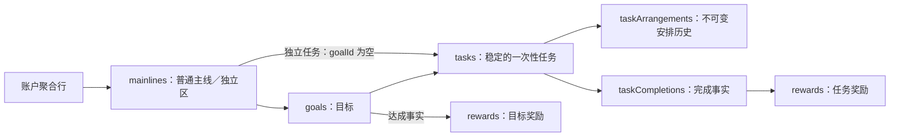

# 后端数据库设计

状态：2026-10-20 设计稿，供评审，暂不实现。沿用已确认的单账户聚合存储决策；以下字段与内部版本是本轮设计选择，不是已执行的数据库变更，也不是最终 HTTP 契约。

本期只包含主线、目标、一次性任务与成长奖励。业务规则见 [规格](spec.md)、[成长与奖励](growth-rewards.md)，处理流程见 [后端业务逻辑](backend-business-logic.md)，前端消费方式见 [前端设计](decisions-frontend.md)。

## 物理表与权限

保留现有 `public.adventure_states` 一张表；六类业务记录存放于 `state`，不新增主线／目标等物理表。现有 DDL 位于 `db/adventure/create-state.sql`，本次不修改或执行 SQL。

| 列 | 类型 | 约束与职责 |
|---|---|---|
| owner_id | uuid | 主键，每个账户一行；只能由服务端已验证身份取得 |
| state | jsonb | 非空且根类型为对象，保存业务事实及逻辑删除记录 |
| journal | jsonb | 非空对象，默认空对象；保存成功命令的摘要与稳定回执 |
| version | bigint | 非负，最大 9007199254740991；每次成功业务写入递增，用于 CAS |
| updated_at | timestamptz | 非空；初始化默认 now()，业务写入使用本次服务端权威时间 |

唯一物理索引沿用 owner_id 主键。本期按 owner_id 读取完整聚合，不增加 JSONB 搜索索引，也不将全部账户拉到 Worker 筛选。

这延续了已有存储取舍：一次写入容易保持全部事实原子一致，但会读写整个账户聚合，同一账户操作不同任务也可能产生版本冲突；不承诺无限历史容量或高并发写入吞吐。本期接受这一约束，不另拆物理表，后续实现须按真实数据规模验证。

沿用现有权限：启用 RLS，撤回 PUBLIC、anon、authenticated 的表权限，不建立浏览器直连策略；service_role 仅 SELECT／INSERT／UPDATE，不授予 DELETE。该角色可绕过 RLS，所以 Worker 每次仍须在线验证身份并限定 owner_id；写入额外限定旧 version。owner_id 沿用无 auth.users 外键的约定，不在本期加入账户删除级联。

## 聚合结构与逻辑关联

内部结构采用新的 schemaVersion=2，timeZone 固定 Asia/Shanghai；state 包含 mainlines、goals、tasks、taskArrangements、taskCompletions、rewards 六个集合。journal 与并发 version 仍在物理列中，不嵌套复制到 state。

图中是逻辑关联，不代表新增 SQL 表、数据库外键或逐记录 SQL 唯一约束。JSONB 内部的 ID 唯一性、引用完整性及业务条件由后端领域 Module 校验，并通过单行 CAS 原子保存。

ID 由服务端生成，作为不透明 UUID 字符串；引用 ID 使用同一类型。时间点是 UTC 时间字符串，业务日期是经过真实日期校验的 YYYY-MM-DD；kind／status 为枚举字符串，focused 为布尔值，order 为非负安全整数，计数／金额为安全整数，ID 列表为字符串数组，snapshot／calculation 为对象。

下面字段除标注可空、可选或仅特定类型／状态存在外均必填；description 和感想未填写时使用空字符串。名称、说明和感想为普通文本，输入长度上限在接口定义时统一确定。

### mainlines：主线与独立区

| 字段 | 含义与约束 |
|---|---|
| id、kind | 稳定标识；kind 为 normal 或 independent，每账户恰好一条 independent |
| name | 当前名称，不用名称识别系统独立身份 |
| status | active／ended；独立区固定 active，普通主线只有手动结束 |
| createdAt、updatedAt、endedAt | 创建、更新及可空结束时间；endedAt 与 ended 状态一致 |

普通主线 active 最多五条，独立区不占名额。主线、目标不提供删除；独立区初始化时由服务端建立，客户端不能创建第二条独立区、改其 kind 或结束它。页面不展示独立区容器。

### goals：目标

| 字段 | 含义与约束 |
|---|---|
| id、mainlineId | 稳定标识及当前归属，必须引用本账户主线记录；创建／迁入仅允许在用普通主线或独立区，终态目标仍保留原主线引用 |
| title、standard | 当前名称及完成标准，必填 |
| status | active／achieved／ended，后两者均不可恢复的终态 |
| focused、order | 聚焦标记与归属内排序键；终态 focused=false |
| createdAt、updatedAt、terminatedAt | 创建、更新、可空终态时间 |
| terminationCause | 可空；手动达成、手动结束或所属主线结束，记录来源 ID |
| attainment | 仅 achieved 时存在：达成日期／时间、目标奖励 ID；具体计奖依据保存在对应奖励事实中 |

每个归属最多三个 active 且 focused 的目标，独立目标共用独立区的三个名额。order 为服务端维护的归属内排序键：展示先聚焦、再按 order；同组排序只调整该组相对顺序，不自动改变聚焦。迁入使用目的归属末尾新键，保证在目的同类组末尾，不改变其他目标相对顺序。

achieved 必须有一份达成事实和一份目标奖励；active／ended 不生成目标奖励。目标进入终态会停止下属任务，但不能把已完成任务改成未完成或删除完成事实。

### tasks：稳定任务

| 字段 | 含义与约束 |
|---|---|
| id、kind | id 同时作为一次性行动的稳定身份；kind 固定 once，不额外建立可漂移的 actionId |
| goalId | 可空；非空引用目标，为空表示直接归属唯一独立区；当前主线由归属解析，不复制第二份可变 mainlineId |
| title、description | 当前名称与可选说明 |
| status | pending／completed／ended；逾期不是存储状态 |
| currentArrangementId | 当前安排引用，必须属于该任务，改期不更换 taskId |
| activeCompletionId | 可空；completed 时指向唯一有效完成，pending／ended 时为空 |
| createdAt、updatedAt、endedAt、endCause | 创建、更新、结束事实及来源 |
| deletedAt | 可空；仅误建删除可设置，逻辑删除后不进入用户可见或有效业务查询 |

状态及 activeCompletionId 是明确的任务生命周期事实，必须与有效完成一致；这与禁止持久保存等级／成就派生状态不同。已完成任务不再改为 ended，上级终态使它只读但保留 completed。

### taskArrangements：执行安排历史

| 字段 | 含义与约束 |
|---|---|
| id、taskId | 安排标识及稳定任务引用 |
| plannedDate | 本次安排的执行日期 |
| previousArrangementId | 首次为空，改期引用该任务的前一次安排，不能形成环 |
| snapshot | 安排形成时的任务名称、说明及当时主线／目标来源 |
| createdAt | 安排形成时间 |

安排记录一经生成，日期和内容快照不可改写。改期追加新记录并切换任务 currentArrangementId；旧记录继续保留，无需改写过去记录的执行结果。历史／当前／停止的展示由当前引用、任务生命周期及完成事实解释，不另维护第二套安排生命周期。

每个非删除任务只有一个当前安排。任务 ended 后停止当前及未来执行权限，但不抹去原安排。修改任务当前名称、说明或迁移当前归属不改写已有安排快照；后续完成按完成时现状生成新的完成快照。

### taskCompletions：完成事实

| 字段 | 含义与约束 |
|---|---|
| id、taskId、arrangementId | 本次完成标识及任务、执行安排引用 |
| completedAt、completedDate | 服务端完成时间及 Asia/Shanghai 日期 |
| snapshot | 完成时的 taskId、名称、说明、mainlineId／名称／kind、可空 goalId／名称／标准、原安排日期与来源 |
| deletedAt | 可空；取消完成时设置，逻辑删除记录保留 |

同一 taskId 最多一条 deletedAt 为空的完成记录。completed 任务的 activeCompletionId 必须指向它。取消具体完成 ID，不能只按任务 ID 删除“当前看到的任意一次完成”；重新完成生成新完成 ID，原逻辑删除记录不复活。

独立任务快照 mainlineId 指向独立区、goalId 为空。历史归属用于计奖和撤销锁定，当前迁移不能改写或绕过它；安排的旧归属不用于阻止迁出后当前任务的合法新完成。

### rewards：奖励事实

| 字段 | 含义与约束 |
|---|---|
| id、kind | 稳定奖励标识，kind 为 task／goal |
| completionId 或 goalId | task 引用具体完成记录，goal 引用已达成目标；两种来源按类型互斥 |
| amount | 正整数；任务固定 1，目标 N>0 时 N×C、N=0 时固定 1 |
| awardedAt、awardedDate | 入账时间及规划日期 |
| calculation | 任务固定计奖依据，或目标的有效完成 ID 列表、去重行动数 N、系数 C、保底／行动计算类型及可选感想 |
| snapshot | 目标达成时名称、标准及归属；任务可通过关联的不可变完成快照读取来源 |
| deletedAt | 可空；取消任务完成时与对应任务奖励同时设置 |

每条有效完成恰好一份有效 task 奖励，每个 achieved 目标恰好一份不可撤销的 goal 奖励。奖励 amount、计奖依据、来源和完成记录必须相互一致；原奖励可以保留逻辑删除记录，但不能继续参与总经验。

目标 N 根据完成时 goalId 选出当前有效完成，再按稳定 taskId 去重；不是当前挂载任务数。目标奖励冻结 countedCompletionIds、N、C 与计算类型，不因后续改名迁移重新解释。成长流水读取有效奖励及发生时快照，目标奖励不增加行动数。

## journal：幂等事实

键沿用 `request:<requestId>`。每条成功回执保存规范化命令的 hash、命令类型、appliedVersion、appliedAt、受影响实体／完成／奖励 ID 及稳定业务结果；不保存完整用户命令副本或一份新的业务状态。

摘要按严格校验后的命令计算：对象键排序、数组顺序保留，不包含 expectedVersion。相同 owner／requestId 与摘要返回原回执；同 key 异命令拒绝。journal 与 state 和 version 同次 CAS 提交，失败命令不写成功回执，不自动裁剪旧 key。

不将 levelBefore、levelAfter、achievementIds、解锁标记或解锁日期保存进新 journal。响应中的等级、成就和操作前后反馈按对应版本实时投影；重复请求返回稳定事实回执与最新投影，不重新发奖或重复提示一次“解锁”事件。

## 一致性、容量与新版本

- 所有引用必须落在同一 owner 聚合内；ID 唯一，删除任务仍保留原记录，不能出现悬空安排、完成或奖励。
- 主线／目标／任务终态传播、聚焦名额、完成唯一性、奖励对应关系和历史锁定在同一次领域命令中校验并提交。物理数据库只保证行主键、列约束及原子行更新，不能把 JSONB 内部不变量误称为数据库外键或唯一约束。
- 账户总经验、等级、本级经验进度、七个成就、成就满足状态、解锁日期及操作能力不持久保存；读取／预览／成功操作后从同一版本有效事实计算，前端只消费结果。
- 按完整候选行的紧凑 UTF-8 序列化大小限制 8,000,000 bytes，包含 state、journal、owner_id、version、updated_at；不是 PostgreSQL 实际存储字节上限。超限拒绝写入，原数据继续可读，不裁剪历史、逻辑删除记录或幂等事实。现有 32 MB 上游读取上限继续有效。
- 本期不增加周期、检查清单、计划结束日期、成就表、等级表或额外增长状态。账户无记录时初始化空业务集合及唯一独立区，不导入原型样例。
- 现有代码是 schemaVersion=1，含周期、持久化成就和旧结算字段，不能冒称已符合本设计。新设计用 schemaVersion=2；旧结构遇到新读写器应明确拒绝或采用单独核准的转换，不能静默覆盖、清空或用空状态替换。模块无线上用户历史，本设计不以旧版历史迁移为开发前置，本次不处理任何验收数据。

## 依据

- 项目现有 DDL：`db/adventure/create-state.sql`；存储 Adapter：`worker/adventure/store.ts`；存储决策：[ADR 0002](../adr/0002-adventure-owner-state.md)。
- [PostgreSQL JSON 类型](https://www.postgresql.org/docs/current/datatype-json.html)：JSONB 的结构能力不等于业务引用约束。
- [Supabase RLS](https://supabase.com/docs/guides/database/postgres/row-level-security)：权限及服务端角色访问边界。
- [PostgREST 事务](https://docs.postgrest.org/en/stable/references/transactions.html)：请求事务及提交行为。

本次只核对本地结构及官方资料，没有连接真实业务数据库、执行 SQL、生成迁移或修改权限。真实实例仍须在后续实现验收中核对，不能从本文件推断线上结构已更新。
