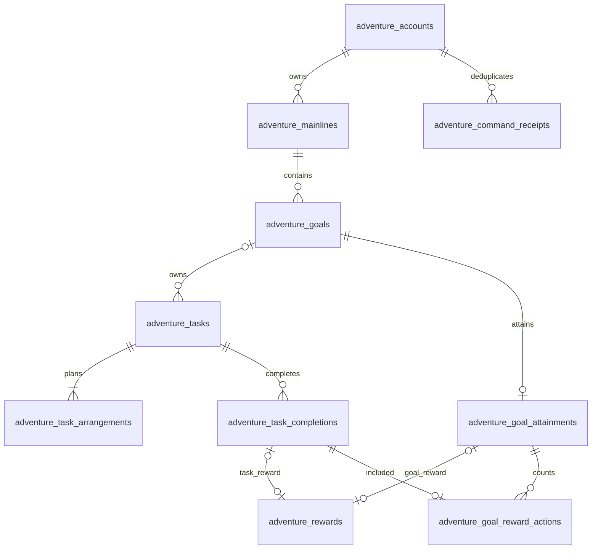

# 后端数据库设计

状态：2026-10-20 多物理表设计稿，供评审，暂不实现。根据用户最新方向，采用关系表保存独立业务事实；下列表名、字段及内部事务入口为本轮设计，不表示表、函数或权限已经创建，也不提前确定完整 HTTP 契约。

不再把主线、目标、任务和奖励保存在一行 state JSONB 中。本期拟使用下列 **10 张物理表**，统一放在 public schema，以 adventure_ 前缀与首页共享 tasks／schedules 区分。等级、成就、总经验和操作能力仍实时计算，不建对应状态表。

业务规则见 [规格](spec.md)、[成长与奖励](growth-rewards.md)，事务和命令流程见 [后端业务逻辑](backend-business-logic.md)，前端消费方式见 [前端设计](decisions-frontend.md)。

## 物理表总览

| 表名 | 作用 |
|---|---|
| `public.adventure_accounts` | 账户元数据与并发版本 |
| `public.adventure_mainlines` | 普通主线与独立区 |
| `public.adventure_goals` | 目标、聚焦与当前归属 |
| `public.adventure_tasks` | 稳定的一次性任务 |
| `public.adventure_task_arrangements` | 不可变执行安排历史 |
| `public.adventure_task_completions` | 真实完成及取消事实 |
| `public.adventure_goal_attainments` | 目标达成与冻结评价 |
| `public.adventure_rewards` | 有效经验来源与取消标记 |
| `public.adventure_goal_reward_actions` | 目标奖励与历史行动的关联 |
| `public.adventure_command_receipts` | 成功命令的幂等回执 |

前六张承载账户、规划、任务及执行事实；后四张承载目标达成、奖励来源、计奖关联与请求幂等。快照和稳定回执允许少量 JSONB，但当前归属、状态、日期、金额及关联 ID 都是有明确 PostgreSQL 类型的独立列。



图中省略各子表到 adventure_accounts 的 owner_id 外键。奖励来源二选一，由行级 CHECK 和事务保证；一份有效完成／达成应有一份对应奖励，由事务补齐，而非只靠外键。独立任务 goal_id 为空，当前归属解析为同账户唯一独立区；历史完成保留当时明确的 mainline_id 和可空 goal_id。

## 字段定义

下表“类型”均为真实 PostgreSQL 列类型，不是 JSON 逻辑类型。状态暂用 text＋CHECK，不新增数据库枚举类型。所有子表的 owner_id 非空，引用 adventure_accounts；所有外键默认 NO ACTION，不物理级联删除历史。

除另有说明外，有 id 的表以 id 为主键，并增加非延迟 UNIQUE(owner_id,id)，供同账户复合外键引用。时间点用 timestamptz，规划日期用 date，后端固定 Asia/Shanghai 解释；名称／标准／说明为普通文本。字段长度沿用现有输入边界，接口阶段统一映射校验提示。

写命令在取得账户锁后捕获一次 clock_timestamp()，显式写入本次事实时间及按规划时区得到的日期，避免锁等待跨日时把事务开始的 now() 与新的日期混用。表中 now() 为列默认值，不替代该命令时间规则。

### `public.adventure_accounts`

账户元数据与并发版本。

| 字段 | PostgreSQL 类型 | 可空 | 默认值 | 约束与含义 |
|---|---|---|---|---|
| `owner_id` | `uuid` | 否 | `无` | 主键；由 Worker 已验证身份取得 |
| `revision` | `bigint` | 否 | `0` | 范围 0..9007199254740991；每次成功命令加一 |
| `time_zone` | `text` | 否 | `'Asia/Shanghai'` | CHECK 固定为 Asia/Shanghai |
| `created_at` | `timestamptz` | 否 | `now()` | 创建时间 |
| `updated_at` | `timestamptz` | 否 | `now()` | 更新时显式设置 |

### `public.adventure_mainlines`

普通主线与独立区。

| 字段 | PostgreSQL 类型 | 可空 | 默认值 | 约束与含义 |
|---|---|---|---|---|
| `id` | `uuid` | 否 | `gen_random_uuid()` | 主键；稳定 ID |
| `owner_id` | `uuid` | 否 | `无` | 引用 adventure_accounts.owner_id |
| `kind` | `text` | 否 | `无` | CHECK IN ('normal','independent') |
| `name` | `varchar(200)` | 否 | `无` | 非空名称 |
| `status` | `text` | 否 | `'active'` | CHECK IN ('active','ended') |
| `created_at` | `timestamptz` | 否 | `now()` | 创建时间 |
| `updated_at` | `timestamptz` | 否 | `now()` | 更新时显式设置 |
| `ended_at` | `timestamptz` | 是 | `NULL` | ended 时非空，active 时为空 |

### `public.adventure_goals`

目标、聚焦与当前归属。

| 字段 | PostgreSQL 类型 | 可空 | 默认值 | 约束与含义 |
|---|---|---|---|---|
| `id` | `uuid` | 否 | `gen_random_uuid()` | 主键；稳定 ID |
| `owner_id` | `uuid` | 否 | `无` | 引用 adventure_accounts.owner_id |
| `mainline_id` | `uuid` | 否 | `无` | 同 owner 的主线引用；历史终态仍保留原引用 |
| `title` | `varchar(200)` | 否 | `无` | 非空名称 |
| `standard` | `text` | 否 | `无` | 非空完成标准，上限 2000 字符 |
| `status` | `text` | 否 | `'active'` | CHECK IN ('active','achieved','ended') |
| `focused` | `boolean` | 否 | `false` | 终态必须为 false |
| `sort_order` | `bigint` | 否 | `0` | 非负安全整数；归属内排序 |
| `created_at` | `timestamptz` | 否 | `now()` | 创建时间 |
| `updated_at` | `timestamptz` | 否 | `now()` | 更新时显式设置 |
| `terminated_at` | `timestamptz` | 是 | `NULL` | 终态时非空 |
| `termination_cause` | `text` | 是 | `NULL` | achieved／ended／mainline_ended；与状态一致 |

### `public.adventure_tasks`

稳定的一次性任务。

| 字段 | PostgreSQL 类型 | 可空 | 默认值 | 约束与含义 |
|---|---|---|---|---|
| `id` | `uuid` | 否 | `gen_random_uuid()` | 主键；稳定 ID |
| `owner_id` | `uuid` | 否 | `无` | 引用 adventure_accounts.owner_id |
| `kind` | `text` | 否 | `'once'` | CHECK kind='once' |
| `goal_id` | `uuid` | 是 | `NULL` | 同 owner 目标；为空表示独立任务 |
| `title` | `varchar(200)` | 否 | `无` | 非空名称 |
| `description` | `text` | 否 | `''` | 可选说明，上限 3000 字符 |
| `status` | `text` | 否 | `'pending'` | CHECK IN ('pending','completed','ended') |
| `current_arrangement_id` | `uuid` | 否 | `无` | 同 owner、同 task 的当前安排；外键延迟到事务结束检查 |
| `active_completion_id` | `uuid` | 是 | `NULL` | completed 时非空；同 task 完成引用，延迟外键 |
| `created_at` | `timestamptz` | 否 | `now()` | 创建时间 |
| `updated_at` | `timestamptz` | 否 | `now()` | 更新时显式设置 |
| `ended_at` | `timestamptz` | 是 | `NULL` | ended 时非空，否则为空 |
| `end_cause` | `text` | 是 | `NULL` | manual／goal_achieved／goal_ended／mainline_ended |
| `deleted_at` | `timestamptz` | 是 | `NULL` | 仅误建删除；不物理删除 |

### `public.adventure_task_arrangements`

不可变执行安排历史。

| 字段 | PostgreSQL 类型 | 可空 | 默认值 | 约束与含义 |
|---|---|---|---|---|
| `id` | `uuid` | 否 | `gen_random_uuid()` | 主键；稳定 ID |
| `owner_id` | `uuid` | 否 | `无` | 引用 adventure_accounts.owner_id |
| `task_id` | `uuid` | 否 | `无` | 同 owner 的任务引用 |
| `planned_date` | `date` | 否 | `无` | 执行日期，原生日期类型 |
| `previous_arrangement_id` | `uuid` | 是 | `NULL` | 同 owner、同 task 的前一次安排，不能引用自身 |
| `mainline_id` | `uuid` | 否 | `无` | 安排形成时的主线／独立区引用 |
| `goal_id` | `uuid` | 是 | `NULL` | 安排形成时目标，独立任务为空 |
| `snapshot` | `jsonb` | 否 | `无` | CHECK 根类型 object；仅保存不可变名称、说明、标准等快照 |
| `created_at` | `timestamptz` | 否 | `now()` | 创建时间 |

### `public.adventure_task_completions`

真实完成及取消事实。

| 字段 | PostgreSQL 类型 | 可空 | 默认值 | 约束与含义 |
|---|---|---|---|---|
| `id` | `uuid` | 否 | `gen_random_uuid()` | 主键；稳定 ID |
| `owner_id` | `uuid` | 否 | `无` | 引用 adventure_accounts.owner_id |
| `task_id` | `uuid` | 否 | `无` | 稳定任务身份 |
| `arrangement_id` | `uuid` | 否 | `无` | 同 owner、同 task 的完成安排 |
| `mainline_id` | `uuid` | 否 | `无` | 完成时主线／独立区引用 |
| `goal_id` | `uuid` | 是 | `NULL` | 完成时目标；用于历史计奖，独立任务为空 |
| `completed_at` | `timestamptz` | 否 | `now()` | 实际完成时间 |
| `completed_on` | `date` | 否 | `无` | 按 Asia/Shanghai 从权威时间取得 |
| `snapshot` | `jsonb` | 否 | `无` | CHECK 根类型 object；不可变完成内容快照 |
| `deleted_at` | `timestamptz` | 是 | `NULL` | 取消时设置；记录保留 |

### `public.adventure_goal_attainments`

目标达成与冻结评价。

| 字段 | PostgreSQL 类型 | 可空 | 默认值 | 约束与含义 |
|---|---|---|---|---|
| `id` | `uuid` | 否 | `gen_random_uuid()` | 主键；稳定 ID |
| `owner_id` | `uuid` | 否 | `无` | 引用 adventure_accounts.owner_id |
| `goal_id` | `uuid` | 否 | `无` | 同 owner 目标；每个目标最多一份达成事实 |
| `mainline_id` | `uuid` | 否 | `无` | 达成时主线／独立区 |
| `coefficient` | `smallint` | 否 | `1` | CHECK IN (1,2,3) |
| `reflection` | `text` | 否 | `''` | 可选感想，上限 3000 字符 |
| `action_count` | `integer` | 否 | `无` | 非负，等于计奖关联表的行动数 |
| `achieved_at` | `timestamptz` | 否 | `now()` | 实际达成时间 |
| `achieved_on` | `date` | 否 | `无` | 规划日期 |
| `snapshot` | `jsonb` | 否 | `无` | CHECK 根类型 object；冻结目标名称、标准和主线名称 |

### `public.adventure_rewards`

有效经验来源与取消标记。

| 字段 | PostgreSQL 类型 | 可空 | 默认值 | 约束与含义 |
|---|---|---|---|---|
| `id` | `uuid` | 否 | `gen_random_uuid()` | 主键；稳定 ID |
| `owner_id` | `uuid` | 否 | `无` | 引用 adventure_accounts.owner_id |
| `kind` | `text` | 否 | `无` | CHECK IN ('task','goal') |
| `completion_id` | `uuid` | 是 | `NULL` | task 奖励必填，goal 奖励为空 |
| `attainment_id` | `uuid` | 是 | `NULL` | goal 奖励必填，task 奖励为空 |
| `amount` | `bigint` | 否 | `无` | 正安全整数；任务固定 1，目标按冻结事实计算 |
| `calculation_type` | `text` | 否 | `无` | fixed_task／goal_actions／goal_minimum，与 kind 一致 |
| `awarded_at` | `timestamptz` | 否 | `now()` | 入账时间 |
| `awarded_on` | `date` | 否 | `无` | 规划日期 |
| `deleted_at` | `timestamptz` | 是 | `NULL` | 任务取消时设置；goal 奖励必须为空 |

### `public.adventure_goal_reward_actions`

目标奖励与历史行动的关联。

| 字段 | PostgreSQL 类型 | 可空 | 默认值 | 约束与含义 |
|---|---|---|---|---|
| `owner_id` | `uuid` | 否 | `无` | 引用 adventure_accounts.owner_id |
| `attainment_id` | `uuid` | 否 | `无` | 引用达成事实，与 goal_id 组成同目标约束 |
| `goal_id` | `uuid` | 否 | `无` | 与达成目标及完成时历史目标一致 |
| `completion_id` | `uuid` | 否 | `无` | 引用计奖完成记录 |
| `task_id` | `uuid` | 否 | `无` | 稳定行动标识，防止同一行动重复参与目标奖励 |
| `created_at` | `timestamptz` | 否 | `now()` | 创建时间 |

### `public.adventure_command_receipts`

成功命令的幂等回执。

| 字段 | PostgreSQL 类型 | 可空 | 默认值 | 约束与含义 |
|---|---|---|---|---|
| `owner_id` | `uuid` | 否 | `无` | 账户外键；联合主键第一部分 |
| `request_id` | `varchar(128)` | 否 | `无` | 联合主键第二部分；命令请求身份 |
| `command_hash` | `varchar(64)` | 否 | `无` | 规范化命令的 64 位十六进制 SHA-256；不包含 expectedVersion |
| `command_type` | `text` | 否 | `无` | 受支持命令类型 |
| `applied_revision` | `bigint` | 否 | `无` | 成功写入后的账户版本，正安全整数 |
| `applied_at` | `timestamptz` | 否 | `now()` | 成功写入时间 |
| `result` | `jsonb` | 否 | `无` | CHECK 根类型 object；只存稳定事实 ID／结果，不存等级或成就状态 |

## 外键、唯一性与索引

### 同账户引用

所有子表先以 owner_id 引用账户。实体引用采用包含 owner_id 的复合外键，防止把其他账户的合法 ID 串进本账户；不能只靠查询条件或全局 UUID 唯一性代替它。

| 子表及列 | 被引用键 | 说明 |
|---|---|---|
| goals(owner_id,mainline_id) | mainlines(owner_id,id) | 当前归属；不要求历史终态主线仍在用 |
| tasks(owner_id,goal_id) | goals(owner_id,id) | goal_id 可空 |
| arrangements(owner_id,task_id) | tasks(owner_id,id) | 稳定任务归属 |
| arrangements(owner_id,task_id,previous_arrangement_id) | arrangements(owner_id,task_id,id) | 前次安排必须属于同任务 |
| tasks(owner_id,id,current_arrangement_id) | arrangements(owner_id,task_id,id) | DEFERRABLE INITIALLY DEFERRED，支持同事务创建任务和首次安排 |
| completions(owner_id,task_id,arrangement_id) | arrangements(owner_id,task_id,id) | 完成不能指向别的任务安排 |
| tasks(owner_id,id,active_completion_id) | completions(owner_id,task_id,id) | DEFERRABLE INITIALLY DEFERRED；仍须校验记录未逻辑删除 |
| arrangements／completions(owner_id,mainline_id) | mainlines(owner_id,id) | 历史主线快照引用 |
| arrangements／completions(owner_id,goal_id) | goals(owner_id,id) | 可空的历史目标引用 |
| attainments(owner_id,goal_id) | goals(owner_id,id) | 每个目标唯一达成事实 |
| attainments(owner_id,mainline_id) | mainlines(owner_id,id) | 达成时归属 |
| rewards(owner_id,completion_id) | completions(owner_id,id) | 任务奖励来源 |
| rewards(owner_id,attainment_id) | attainments(owner_id,id) | 目标奖励来源 |
| goal_reward_actions(owner_id,attainment_id,goal_id) | attainments(owner_id,id,goal_id) | 与目标达成事实同目标 |
| goal_reward_actions(owner_id,completion_id,task_id,goal_id) | completions(owner_id,id,task_id,goal_id) | 必须是该任务在该目标下完成的历史行动 |

表格中 mainlines 等为去掉 adventure_ 前缀的简写。为复合外键增加所需的普通非延迟唯一键：arrangements(owner_id,task_id,id)、completions(owner_id,task_id,id)、completions(owner_id,id,task_id,goal_id)、attainments(owner_id,id,goal_id)。外键引用这些完整唯一键，不引用下面的部分唯一索引。

历史 completion.mainline_id 不与 goal 当前 mainline_id 绑定相等，否则目标迁移会破坏历史归属。独立任务完成的 goal_id 为 NULL，不能进入需要非空 goal_id 的目标计奖关联。

### 唯一性与检查

| 约束 | 数据库保证的事实 |
|---|---|
| mainlines(owner_id) WHERE kind='independent' 唯一 | 每账户最多一个独立区；初始化事务建立并维护恰好一个 |
| completions(owner_id,task_id) WHERE deleted_at IS NULL 唯一 | 同一任务最多一条有效完成 |
| attainments(owner_id,goal_id) 唯一 | 一个目标不能达成两次 |
| rewards(owner_id,completion_id) 唯一 | 一次完成只有一份任务奖励，取消后不以同完成 ID 重发 |
| rewards(owner_id,attainment_id) 唯一 | 一份达成事实只有一份目标奖励 |
| goal_reward_actions 主键(owner_id,attainment_id,task_id) | 同一目标奖励内同一行动不重复 |
| goal_reward_actions(owner_id,task_id) 唯一 | 同一稳定行动不参与多个目标奖励 |
| receipts 主键(owner_id,request_id) | 同账户请求身份唯一 |
| receipts(owner_id,applied_revision) 唯一 | 每次成功写入版本对应一个命令回执 |

部分唯一索引在记录逻辑删除后允许同一 task_id 产生新的有效完成，但旧记录保留；普通来源唯一键仍保证旧完成不会生成第二份奖励。

行级 CHECK 覆盖：kind／status 枚举、正经验、非负计数、revision／排序／金额安全整数范围；独立区永不 ended；终态时间与状态一致；任务 completed 时 active_completion_id 非空，其他状态为空；奖励 kind 与两种来源互斥、计算类型一致，goal 奖励 deleted_at 必须为空；JSONB 根类型为 object；前次安排不能引用自身。全账户有效经验之和也须在返回格式可精确表达的安全整数范围内，越界时事务整体拒绝。

以下必须在事务业务校验中保证，不能写成跨行 CHECK：最多五条在用主线、每归属三个聚焦目标、日期与只读规则、安排链无环、当前完成确实有效、达成／奖励／计奖关联完整一致、取消完成与奖励一起逻辑删除。所有普通写入必须走同一个事务入口，禁止 Handler 直接逐表散写。

### 查询索引

- goals(owner_id,mainline_id,status,focused DESC,sort_order,id)：归属分组和排序；goals(owner_id,status)：目标统计。
- tasks(owner_id,goal_id,status)：目标下当前任务；arrangements(owner_id,planned_date,task_id)：日期范围查询，必须联结任务的 current_arrangement_id，不能把旧安排当成新任务。
- arrangements(owner_id,task_id,created_at,id)：单任务安排历史。
- completions(owner_id,goal_id,completed_on,id) WHERE deleted_at IS NULL：目标历史计奖和有效行动。
- rewards(owner_id,awarded_at DESC,id) WHERE deleted_at IS NULL：有效流水游标分页及账户经验汇总。
- 已有主键／唯一键同时承担来源查找与请求去重，不重复建立同形索引。具体执行计划在实现验收时确认，不预先宣称性能通过。

## 快照与回执的 JSONB

只有不可变历史内容和稳定操作回执使用 JSONB，不再保存整账户 state 或 journal 对象。历史引用 ID、日期、计数、评价、金额均为上面的真实列。

| 所属列 | JSON 子字段与类型 |
|---|---|
| arrangements.snapshot | title:text、description:text、mainlineName:text、mainlineKind:'normal'／'independent'、goalTitle:text／null、goalStandard:text／null |
| completions.snapshot | 同上，另含 plannedDate:'YYYY-MM-DD' |
| attainments.snapshot | title:text、standard:text、mainlineName:text、mainlineKind:'normal'／'independent' |
| receipts.result | 本次受影响的实体／完成／奖励 UUID 及稳定事实结果；具体对象结构在接口阶段统一 |

快照由可信事务入口从当时数据构造，不接受客户端上传已算出的完整快照；写入后不随改名或迁移改写。回执不保存等级、成就、解锁状态或解锁日期。

## 事务、权限与版本

拆表后不能用多次独立 REST 写入模拟事务。设计采用单次服务端专用数据库函数 RPC：在一个 PostgreSQL 事务中完成最终校验、业务记录写入、回执和 accounts.revision 加一；失败全部回滚，网络超时仍按结果未知处理。

Worker 负责在线鉴权、严格输入类型和命令封套，把可信 owner 传入后端事务入口；入口锁定该账户元数据行 FOR UPDATE，先查回执再核对 expectedVersion。最终业务判定与更新集中于数据库事务 Module；能力和预览复用其后端判定函数，Worker 不另写一套计奖／终态算法，前端不计算业务。

本期保留账户级 expectedVersion 语义：拆表解决记录独立存储、关联约束和查询，不自动改成不同任务独立写入；同账户不同操作仍可能产生版本冲突。读取／预览在短事务内对账户行取 FOR SHARE，再查询该账户多表，使事实、revision 和成长投影一致；所有写入先取得该账户 FOR UPDATE，事务期间不等待浏览器确认或调用外部服务。

涉及 FOR SHARE 的读取／预览使用后端 POST RPC 的可读写事务入口，不能错误配置成 PostgreSQL READ ONLY 事务或 PostgREST 的 STABLE／GET 入口；其业务语义仍不写事实。浏览器的 HTTP 读取接口形式留下一阶段定义，由 Worker 适配内部 RPC。

全部十张表启用 RLS，撤回 PUBLIC／anon／authenticated 的直接权限，不新增浏览器直连策略。service_role 仅获必需 SELECT／INSERT／UPDATE，不授予物理 DELETE；RPC 使用 SECURITY INVOKER，显式撤回 PUBLIC／anon／authenticated 的 EXECUTE，仅后端角色可调用，并固定 search_path、完整限定表名。角色权限不替代 owner 条件与复合外键。

owner_id 继续不对 auth.users 建级联外键，避免擅自决定账户删除语义；内部表外键只连 adventure_accounts。事务初始化账户及唯一独立区，其余表为空，不能导入原型数据。

不再使用单行 8 MB 上限、state.schemaVersion=2 或整账户 JSON PATCH；改为分记录存储、分页读取、事务查询及返回量预算。客户端命令 128 KiB／5 秒读取、上游调用超时及脱敏仍沿用；事务时长、锁等待和页面返回上限在接口容量设计中明确。超限拒绝整笔操作，不能只传播一部分终态，也不裁剪历史或幂等回执。

## 多表 JSON 示例

以下按物理表列展示同一账户的一组样例行，每条记录写出全部列；不是接口响应，也不展示全部既往命令。样例为一个已达成目标、一项已完成任务、1 点任务奖励及 1×2=2 点目标奖励，总经验实时求和为 3。所有值均为虚构，不表示已经写入数据库。

```json
{
  "public.adventure_accounts": [
    {
      "owner_id": "10000000-0000-4000-8000-000000000001",
      "revision": 7,
      "time_zone": "Asia/Shanghai",
      "created_at": "2026-10-20T01:00:00Z",
      "updated_at": "2026-10-20T04:30:00Z"
    }
  ],
  "public.adventure_mainlines": [
    {
      "id": "20000000-0000-4000-8000-000000000001",
      "owner_id": "10000000-0000-4000-8000-000000000001",
      "kind": "independent",
      "name": "独立区",
      "status": "active",
      "created_at": "2026-10-20T01:00:00Z",
      "updated_at": "2026-10-20T01:00:00Z",
      "ended_at": null
    },
    {
      "id": "20000000-0000-4000-8000-000000000002",
      "owner_id": "10000000-0000-4000-8000-000000000001",
      "kind": "normal",
      "name": "健康与活力",
      "status": "active",
      "created_at": "2026-10-20T01:00:00Z",
      "updated_at": "2026-10-20T01:00:00Z",
      "ended_at": null
    }
  ],
  "public.adventure_goals": [
    {
      "id": "30000000-0000-4000-8000-000000000001",
      "owner_id": "10000000-0000-4000-8000-000000000001",
      "mainline_id": "20000000-0000-4000-8000-000000000002",
      "title": "完成一次 10 公里越野",
      "standard": "在户外连续完成 10 公里路线，并记录一次体验。",
      "status": "achieved",
      "focused": false,
      "sort_order": 0,
      "created_at": "2026-10-20T01:00:00Z",
      "updated_at": "2026-10-20T04:30:00Z",
      "terminated_at": "2026-10-20T04:30:00Z",
      "termination_cause": "achieved"
    }
  ],
  "public.adventure_tasks": [
    {
      "id": "40000000-0000-4000-8000-000000000001",
      "owner_id": "10000000-0000-4000-8000-000000000001",
      "kind": "once",
      "goal_id": "30000000-0000-4000-8000-000000000001",
      "title": "完成一次 5 公里适应跑",
      "description": "",
      "status": "completed",
      "current_arrangement_id": "50000000-0000-4000-8000-000000000001",
      "active_completion_id": "60000000-0000-4000-8000-000000000001",
      "created_at": "2026-10-20T01:00:00Z",
      "updated_at": "2026-10-20T04:20:00Z",
      "ended_at": null,
      "end_cause": null,
      "deleted_at": null
    }
  ],
  "public.adventure_task_arrangements": [
    {
      "id": "50000000-0000-4000-8000-000000000001",
      "owner_id": "10000000-0000-4000-8000-000000000001",
      "task_id": "40000000-0000-4000-8000-000000000001",
      "planned_date": "2026-10-20",
      "previous_arrangement_id": null,
      "mainline_id": "20000000-0000-4000-8000-000000000002",
      "goal_id": "30000000-0000-4000-8000-000000000001",
      "snapshot": {
        "title": "完成一次 5 公里适应跑",
        "description": "",
        "mainlineName": "健康与活力",
        "mainlineKind": "normal",
        "goalTitle": "完成一次 10 公里越野",
        "goalStandard": "在户外连续完成 10 公里路线，并记录一次体验。"
      },
      "created_at": "2026-10-20T01:00:00Z"
    }
  ],
  "public.adventure_task_completions": [
    {
      "id": "60000000-0000-4000-8000-000000000001",
      "owner_id": "10000000-0000-4000-8000-000000000001",
      "task_id": "40000000-0000-4000-8000-000000000001",
      "arrangement_id": "50000000-0000-4000-8000-000000000001",
      "mainline_id": "20000000-0000-4000-8000-000000000002",
      "goal_id": "30000000-0000-4000-8000-000000000001",
      "completed_at": "2026-10-20T04:20:00Z",
      "completed_on": "2026-10-20",
      "snapshot": {
        "title": "完成一次 5 公里适应跑",
        "description": "",
        "mainlineName": "健康与活力",
        "mainlineKind": "normal",
        "goalTitle": "完成一次 10 公里越野",
        "goalStandard": "在户外连续完成 10 公里路线，并记录一次体验。",
        "plannedDate": "2026-10-20"
      },
      "deleted_at": null
    }
  ],
  "public.adventure_goal_attainments": [
    {
      "id": "80000000-0000-4000-8000-000000000001",
      "owner_id": "10000000-0000-4000-8000-000000000001",
      "goal_id": "30000000-0000-4000-8000-000000000001",
      "mainline_id": "20000000-0000-4000-8000-000000000002",
      "coefficient": 2,
      "reflection": "一步一步完成了。",
      "action_count": 1,
      "achieved_at": "2026-10-20T04:30:00Z",
      "achieved_on": "2026-10-20",
      "snapshot": {
        "title": "完成一次 10 公里越野",
        "standard": "在户外连续完成 10 公里路线，并记录一次体验。",
        "mainlineName": "健康与活力",
        "mainlineKind": "normal"
      }
    }
  ],
  "public.adventure_rewards": [
    {
      "id": "70000000-0000-4000-8000-000000000001",
      "owner_id": "10000000-0000-4000-8000-000000000001",
      "kind": "task",
      "completion_id": "60000000-0000-4000-8000-000000000001",
      "attainment_id": null,
      "amount": 1,
      "calculation_type": "fixed_task",
      "awarded_at": "2026-10-20T04:20:00Z",
      "awarded_on": "2026-10-20",
      "deleted_at": null
    },
    {
      "id": "70000000-0000-4000-8000-000000000002",
      "owner_id": "10000000-0000-4000-8000-000000000001",
      "kind": "goal",
      "completion_id": null,
      "attainment_id": "80000000-0000-4000-8000-000000000001",
      "amount": 2,
      "calculation_type": "goal_actions",
      "awarded_at": "2026-10-20T04:30:00Z",
      "awarded_on": "2026-10-20",
      "deleted_at": null
    }
  ],
  "public.adventure_goal_reward_actions": [
    {
      "owner_id": "10000000-0000-4000-8000-000000000001",
      "attainment_id": "80000000-0000-4000-8000-000000000001",
      "goal_id": "30000000-0000-4000-8000-000000000001",
      "completion_id": "60000000-0000-4000-8000-000000000001",
      "task_id": "40000000-0000-4000-8000-000000000001",
      "created_at": "2026-10-20T04:30:00Z"
    }
  ],
  "public.adventure_command_receipts": [
    {
      "owner_id": "10000000-0000-4000-8000-000000000001",
      "request_id": "demo-complete-goal-01",
      "command_hash": "0123456789abcdef0123456789abcdef0123456789abcdef0123456789abcdef",
      "command_type": "completeGoal",
      "applied_revision": 7,
      "applied_at": "2026-10-20T04:30:00Z",
      "result": {
        "goalId": "30000000-0000-4000-8000-000000000001",
        "attainmentId": "80000000-0000-4000-8000-000000000001",
        "rewardIds": [
          "70000000-0000-4000-8000-000000000002"
        ]
      }
    }
  ]
}
```

## 实施边界与依据

本设计替换单行聚合方案，但现有代码和 `db/adventure/create-state.sql` 仍是旧实现，本次不改它们。模块尚无需要兼容的线上用户历史，不把旧版迁移作为前置；也不自动删除、清空或转换现有验收数据。后续建表与函数必须单独生成并审阅迁移，确认实际 PostgreSQL／Supabase 环境后验证。

- [PostgreSQL 约束](https://www.postgresql.org/docs/current/ddl-constraints.html) 与 [CREATE TABLE](https://www.postgresql.org/docs/current/sql-createtable.html)：复合外键及可延迟约束。
- [部分索引](https://www.postgresql.org/docs/current/indexes-partial.html)：有效完成的部分唯一索引。
- [Supabase 数据库函数](https://supabase.com/docs/guides/database/functions) 与 [PostgREST 事务](https://docs.postgrest.org/en/stable/references/transactions.html)：单次后端 RPC 的事务入口及函数权限。

以上只完成设计与静态校对；没有连接业务数据库、执行 SQL、创建表／函数、迁移数据或调整权限。
