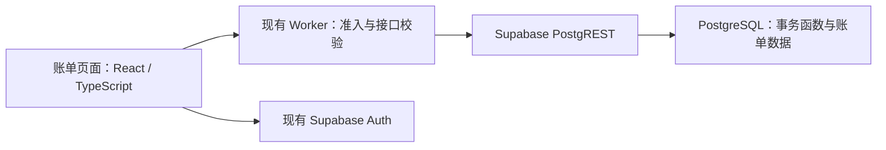

# 个人账单技术方案

状态：产品、原型、接口与两表结构已完成对齐，当前可进入开发准备。按使用者“正常能使用，不需要过度考虑极限场景”的要求收敛，取消跨刷新提交暂存、恢复流程及问题 42；本期不做备份。本文为后续开发的技术方案，尚未实施。产品规则见 [需求明细](requirements-draft.md)。

## 现有项目事实

| 范围 | 可复用实现 |
| --- | --- |
| 网页 | React、TypeScript、Vite；`src/app/App.tsx` 使用轻量路由，正式财务页尚未接入 |
| 身份与准入 | Supabase Auth SDK 管理前端会话；`worker/auth.ts` 逐次在线验证身份、会话和白名单 |
| 业务入口 | `src/auth/request.ts` 提供按所有者核对的读取与写入；`worker/index.ts` 提供统一鉴权、错误格式与 `no-store` |
| 数据调用 | `worker/adventure/planning.ts` 使用服务端凭据调用 Supabase PostgREST RPC，并从可信身份注入所有者 |
| 当前数据库项目 | 按仓库 `SUPABASE_URL` 的项目标识只读核验：项目当前显示名为 `lifespace`，旧文档称 `personal_os`；复用的是同一项目，所属组织当前为 Free |
| 事务与幂等 | `db/adventure/create-planning.sql` 使用数据库事务、行锁、请求编号和成功回执；账单可复用模式，独立设计数据结构 |
| 验证 | 仓库已有临时 PostgreSQL / PostgREST 执行器；当前 CI 未启动该数据库环境，不能将跳过的数据库套件计为真实数据库验证通过 |

本轮核对仓库实现、官方资料，以及 Supabase 项目和组织的只读元数据；没有查询业务数据，也没有修改远端数据库、套餐或部署。

## 已确认的整体结构

在现有 LifeSpace 中交付财务页，复用 React、Cloudflare Worker、现有 Supabase 项目与登录体系；该项目当前名为 `lifespace`，旧文档中的 `personal_os` 指同一项目。账单使用独立业务表和接口。正式页面拟用 `/finance`，接口拟用 `/api/ledger/*`，具体接口契约在后续细化。

### 各层职责

- 前端：实现已确认原型，字段校验用于即时反馈；列表与详情按所有者隔离状态。提交期间防重复点击，当前页面内的重试沿用原请求编号；网络异常时提示查看结果。
- Worker：逐次验证身份与白名单，所有者来自可信身份；校验请求及数据库响应，映射明确业务错误，不接收任意所有者或任意字段更新请求。
- 数据库：在单次事务中校验业务条件、按创建请求编号去重、写流水、处理联动删除及版本变更。并发退款和删除的正确性由数据库保证。

现有服务端凭据可绕过 RLS，因此开启 RLS 不能代替 RPC 内的所有者条件。建议沿用业务表与函数仅对服务端角色开放的边界，并显式核对所有者、父流水归属和删除状态。

### 数据表达

- 流水仅存收入／支出两个方向，退款归为收入；通过可空父流水标识区分普通收入与退款，退款关系必须属于同一所有者。
- 金额采用有符号整数“分”，数据库使用 `bigint`，最大绝对值为 `99,999,999,999` 分；接口同样校验整数与金额边界。
- 交易时间与创建时间分别保存。交易时间精确到秒，传输与存储采用 UTC，显示和日期筛选按 `Asia/Shanghai`；以服务端时间限制未来输入。
- 交易账户保留手填名称；分类采用稳定代码及固定显示名称。退款账户与分类由服务端继承父流水。
- 原交易字段不可编辑。状态由全部未删除退款推导，不另存一个可由客户端修改的状态值。
- 流水自身保留创建请求编号，逻辑删除后仍参与请求去重；旧请求重试不重新创建流水，也不返回已删除的交易正文。

上述规则用于后续实现，当前不执行数据库迁移。

## 已确认的架构边界（35–38）

使用者以一次 `yes` 接受下列四项推荐。

| 编号 | 问题 | 已确认结论 |
| --- | --- | --- |
| 35 | 应用与基础设施归属 | 在现有 LifeSpace 中交付财务页，复用 React / Worker / 现有 Supabase 项目（现名 `lifespace`，旧称 `personal_os`），账单使用独立业务表与接口 |
| 36 | 第一版设计验证规模 | 面向个人和少量白名单使用者、低并发，以单用户累计 10 万条流水作为索引与分页的验证规模；这不是产品条数上限，也不是未经测试的性能承诺 |
| 37 | 多设备数据刷新 | 进入页面、重新聚焦与成功写入后获取最新数据，提供手动刷新；第一版不引入后台实时推送 |
| 38 | 浏览期间数据变化与分页一致性 | 读取分页时核对列表版本。其他设备写入导致版本变化时，提示列表已更新，保留日期筛选并回到第一页重新读取，避免混用新旧列表；本页主动删除仍遵守已定的保留当前有效页规则 |

列表版本用于识别分页数据变化，普通创建不要求携带整个账户的旧版本，不让无关的新建互相报版本冲突。

## 数据与事务

只使用两张账单表：

字段、关联、约束和示例见 [数据库设计](database-design.md)。接口已由使用者确认，本轮细化数据库表设计。

| 表 | 职责 |
| --- | --- |
| `ledger_entries` | 保存普通收入、普通支出和退款、所有者、原始交易字段、父流水关联、逻辑删除标记及唯一创建请求编号 |
| `ledger_owner_revision` | 每个所有者一行，保存列表版本并提供短事务锁；它不是使用者手填的交易账户 |

同一所有者的写事务先锁定版本行，在全部流水中核对创建请求编号或目标删除状态，完成业务校验及实际写入，再更新版本并一并提交；不同所有者互不共用这把锁。读取列表在一个短事务中持有同一所有者的共享锁，保证条目、总数、版本与派生退款状态来自一致的业务状态。锁只覆盖数据库操作，不跨用户确认或网络等待。

同一用户的独立写入在数据库内依次执行，界面仍允许继续提交其他操作。普通创建不要求携带整个账户的旧版本；删除确认单独比较父流水和全部有效退款标识构成的影响范围，不因无关新建而要求重新确认。

流水保留交易时间、创建时间、所有者、收支方向、金额、交易账户名称、分类代码、备注、可空父流水标识和删除标记。`direction` 只有 `income`、`expense`，收入具有父支出关联即为退款。活跃列表索引按所有者、交易时间倒序、标识倒序建立；另为父流水的有效退款查询建立索引。使用 30 条编号分页和版本核对，并按已确认的 10 万条目标验证列表与分页性能。

前端读取使用已安装的 TanStack Query，查询键包含所有者与查询条件，响应携带列表版本。请求与响应使用共享 Zod 契约和现有鉴权请求封装；不增加任意编辑入口。

## 提交与异常处理

- 普通新建和退款各自生成独立请求编号；同一次操作重复点击或在当前页面重试沿用该编号，通过流水表的 `UNIQUE (owner_id, request_id)` 去重，包含已逻辑删除记录。
- 删除按目标流水标识处理，已经删除则直接返回成功；没有实际变更不递增版本。首次删除仍在事务内核对影响范围、处理父子逻辑删除。
- 当前页面只在内存中保留正在处理的请求；不同真实交易即使字段相同也不合并。
- 请求之间独立处理，不因一笔结果未知而禁止其他新建、退款或删除。
- 保存成功后重读数据；只有响应仍对应当前表单时才关闭该表单，避免关闭后来打开的新表单。保存成功但重读失败时只重试读取。
- 网络中断或超时时，明确提示结果尚未确认，允许刷新列表查看。刷新或离开后不恢复旧请求，不自动重新提交。
- 不使用浏览器持久存储保存交易命令，不建设跨刷新恢复队列，也不因本地存储不可用而阻止正常提交。
- 已确认的金额、时间、退款额度、删除范围和所有者校验继续执行。

此前问题 39 的跨刷新暂存建议由使用者最新的简化要求取代；问题 40 的不限制其他操作继续成立，问题 42 不再需要决策。见 [已撤销的恢复方案记录](../adr/0004-ledger-pending-operations.md)。

## 接口与流程

| 接口 | 用途 |
| --- | --- |
| `GET /api/ledger/entries` | 按日期条件、页码和可选列表版本读取本人流水 |
| `GET /api/ledger/entries/:id` | 查看本人未删除流水及退款关联 |
| `POST /api/ledger/entries` | 新建普通收入或支出 |
| `POST /api/ledger/entries/:id/refunds` | 为普通支出登记退款，服务端继承账户与分类 |
| `GET /api/ledger/entries/:id/delete-preview` | 读取删除摘要、关联退款数量与影响范围标识 |
| `POST /api/ledger/entries/:id/delete` | 核对影响范围后，在事务内逻辑删除 |

创建、退款和删除沿用现有 POST 写入封装，身份由 Worker 注入。删除范围变化返回明确冲突，更新确认内容后再操作；没有修改流水字段的接口。

## 接入前统一的实现口径

以下属于工程映射，已按现有需求统一，不增加新的产品决策。

| 含义 | 数据库 | 正式 JSON 接口 | 原型当前表达 |
| --- | --- | --- | --- |
| 收支方向 | `direction` | `direction` | `direction`，均为 `income`／`expense` |
| 创建请求编号 | `request_id` | 新建与退款提交中的 `requestId` | 原型尚无正式请求 |
| 金额（分） | `amount_cents` | `amountCents` | `amountCents` |
| 交易时间 | `occurred_at` | `occurredAt` | `occurredAt` |
| 交易账户名称 | `account_name` | `accountName` | `account` |
| 固定分类 | `category_code` | `categoryCode` | `category`，目前使用中文显示名 |
| 父流水 | `parent_entry_id` | `parentEntryId`，普通流水为 `null` | `parentId`，普通流水不设置 |
| 创建时间 | `created_at` | `createdAt` | 原型未单独保存 |
| 交易状态 | 不单独存列 | `status`，由服务端计算 | 原型由内存数据计算 |

- 用户输入金额绝对值，界面按收支方向生成有符号整数分；接口和数据库均校验符号、非零与上限。金额不以浮点“元”在各层反复计算。
- 时间接口使用 UTC 的 ISO 8601 字符串，界面显示北京时间。日期筛选传 `startDate`／`endDate`（`YYYY-MM-DD`，北京时间自然日），无日期条件时均省略；服务端转为开始日零点至结束日次日零点的左闭右开区间，保留首尾两天。
- 分类在共享契约中维护固定代码和中文显示名，顺序沿用已确认清单；退款继承父支出代码，不能用普通收入菜单替换。
- 返回状态使用原型既有的 `completed`、`partial-refund`、`full-refund`；退款身份由收入且存在父关联推导。状态计算使用所有未删除关联退款，不受当前筛选或页码影响。
- 分页输入使用 `page`（默认 1）与可选 `version`；每页固定 30 条，响应包含 `items`、`total`、`page`、`pageSize`、`version`。日期条件改变时回第一页，重新读取版本。
- `owner_id` 由 Worker 的已验证身份提供，客户端不能通过请求体指定归属。请求与响应使用共享契约校验，数据库约束沿用相同的业务枚举与取值界限。
- 正式财务页接入既有登录、接口和导航，原型的模拟数据、重置入口、数据面板及全量流水调试日志不带入正式页面。

## 本期备份范围

使用者在了解备份含义后明确“不需要备份”。本期不建设备份任务、异地存储、备份保留与灾难恢复流程，也不采用此前建议的 24 小时数据丢失窗口或恢复目标。备份不再作为本期技术决策或上线验收项。

## 实施与验证

1. 按项目约定整理 GitHub 规格与开发任务，再交付数据库表、索引、事务函数和基本权限校验，接入 Worker 接口与共享契约。
2. 将已确认原型的交互用于正式财务页，接入现有导航、登录和数据读取。
3. 验证新建、列表与日期分页、部分与全部退款、单独退款删除、父子联动删除及账户隔离；用真实数据库检查事务和重复请求去重。
4. 运行类型、构建及关键浏览器流程检查，按项目既有 Issue、PR 和部署验收流程交付。

本轮不再为罕见故障增加交互或继续访谈。当前仅更新方案文档，正式功能尚未开发。

## 开发准备检查结论

已交叉核对需求、数据库设计、技术方案，以及 `CONTEXT.md`、账单 ADR、`PRODUCT.md` 和原型 README／交互记录。当前两表方案、收入退款归类、原始金额、派生状态、分类继承、逻辑删除与分页规则一致，没有新增的业务或设计阻碍。

可以进入任务拆解与正式开发。按既有仓库流程，先登记规格和开发 Issue、保留原型来源并建立功能分支；实际建表前读取现有数据库结构。随后按数据库事务、Worker 接口、正式页面、联调验收的顺序实施。

本轮完成的是文档一致性检查；数据库约束、事务和正式接口仍须在实现后验证。

## 官方依据

- [Supabase RLS 与服务端角色边界](https://supabase.com/docs/guides/database/postgres/row-level-security)
- [PostgreSQL 显式锁与行锁](https://www.postgresql.org/docs/current/explicit-locking.html)
- [PostgreSQL 数值类型](https://www.postgresql.org/docs/current/datatype-numeric.html)
- [Cloudflare Worker 与静态资源路由](https://developers.cloudflare.com/workers/static-assets/routing/worker-script/)

资料核对日期：2026-10-31。已只读核对项目显示名、健康状态与组织 Free 套餐；未检查业务数据、容量、实际备份、恢复能力或部署版本。
