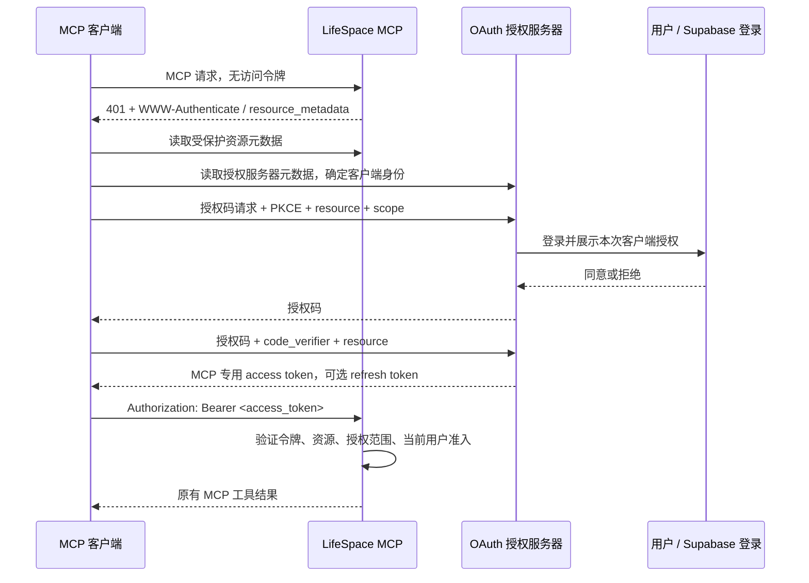

# MCP HTTPS 认证调研与 LifeSpace 调整建议

> 实施状态（#193）：用户已批准本文推荐方案。本 worktree 已实现同 Worker OAuth、独立资源 token、工具 scope、同意与授权管理及数据库撤销检查；尚待最终评审、具体合并发布授权与真实客户端/生产验收。最终设计见 [ADR 0012](adr/0012-mcp-oauth-grants.md)，配置和传播边界见 [运维说明](mcp-oauth-operations.md)。下文“当前实现”“建议”“未实施”的表述是调研时的历史基线，不再表示尚未获得实施授权。

原交接文档 SHA-256 为 `b3158d60e9fe9027c92d2cf5cb46a784436aee1db8d6ef7fc76d99bd9db47c71`，原 SVG 为 `733c9347cc2ba63da8df81f930cda9a2cf604f0be9188275959d6b73a5f224d7`；本次按实际实施更新并纳入 Git，原 main 工作区素材未被修改。


调研日期：2026-11-14。本文是研究与方案建议，不是已批准的架构决策，也不表示已经修改或部署认证。

方案图：[现状与需要变更的地方（SVG）](design/mcp-https-auth.svg)。

代码基线为本地 `707f844523391062985c668e02e9870299d56b51`。通过 GitHub 连接器对比远端 `main`：领先本地 4 个提交，差异未涉及本文分析的 Worker 鉴权、MCP、账单服务及 Agent 测试文件。本文核对源码与公开官方资料，没有检查生产 Access 策略、实际密钥、数据库授权记录或真实客户端连接。

## 结论

LifeSpace 当前采用 **Cloudflare Access Service Token + 签名断言 + 服务端用户绑定**。这是面向可配置自定义请求头的客户端的专用接入方式；若目标是通用 MCP 客户端通过 URL 自动发现并让用户授权，应提供 MCP 的 OAuth 授权流程，而不只是更换请求头。[现有接入说明](agent-mcp.md)、[ADR 0009](adr/0009-agent-service-token-access.md)、[Cloudflare Service Token 文档][cf-service]

建议保留 Supabase 登录和既有账单服务，增加 **面向 MCP 的 OAuth 授权服务器及独立访问令牌**：用户在 LifeSpace 登录并同意权限，Agent 获得仅适用于 `/api/agent/mcp` 的令牌。Cloudflare 官方 `@cloudflare/workers-oauth-provider` 是适配现有 Workers 部署的候选实现，支持单 Worker 及授权服务器与资源服务器分离两种形式；无需为了 OAuth 重写全部业务或同时更换 MCP 传输实现。[Cloudflare 授权指南][cf-auth]、[官方库 README][cf-provider]

不建议直接把网页 Supabase access token 交给 Agent，也不建议只启用 Supabase OAuth Server 就认为完成隔离。其官方文档说明默认 OAuth token 带 `aud: authenticated`、`role: authenticated` 和 `client_id`，`openid/email/profile/phone` scope 不限制业务 API；当前网页 `verifyIdentity()` 又不区分 `client_id` 或 MCP 专用 audience。这条直连路线必须另外验证资源绑定，并补齐 Worker 授权隔离。[Supabase Token Security][sb-security]、[现有网页鉴权](../worker/auth.ts)

## 规范版本和要求边界

本次用官方版本页与 Release 双重核对：**`2026-07-28` 是当前已发布的 MCP 稳定版**；`specification/draft` 是下一版本的工作稿。OAuth 2.1 本身仍是 IETF Internet-Draft，不能称为已发布的 OAuth 2.1 RFC；本文依据 MCP 稳定版所引用的 OAuth 标准集合。[MCP 版本说明][mcp-version]、[官方 Release][mcp-release]、[OAuth 2.1 状态][oauth21]

MCP 授权能力整体为 **OPTIONAL**，支持授权的 HTTP 实现 **SHOULD** 遵循该授权规范。因此不能把现有专用认证简单判成“违反所有 MCP 要求”；这里的迁移目标是标准 OAuth 互操作。选择该路径后，其内部的 MUST 要求需要落实。[MCP 授权规范][mcp-auth]

| 能力 | 当前稳定规范的要求 | 本项目建议 |
| --- | --- | --- |
| 受保护资源元数据 | MCP server **MUST** 实现 RFC 9728，至少声明一个授权服务器；支持 challenge 或 well-known 发现 | 同时实现路径元数据和 401 的 `resource_metadata` 指引 |
| 授权服务器发现 | AS **MUST** 提供 RFC 8414 或 OIDC Discovery 至少一种；客户端 **MUST** 支持两种 | 直接使用 OAuth 库提供的 metadata，核对 issuer、端点与能力 |
| PKCE | MCP 客户端 **MUST** 实现；支持时 **MUST** 用 S256，且必须查验 AS metadata 的 PKCE 能力 | metadata 声明 `code_challenge_methods_supported: ["S256"]`，MCP 授权流程强制验证 |
| 资源绑定 | 客户端 **MUST** 在授权与 token 请求携带 `resource`；资源服务器 **MUST** 验证令牌为自身资源签发 | 使用 MCP URL 作为规范资源标识，并显式验证令牌绑定 |
| 注册方式 | 授权前 **MUST** 有 client ID；有现成预注册信息时优先使用，其次 CIMD，再 DCR fallback | 兼容已预注册客户端，新增实现优先支持 CIMD |
| CIMD | MCP client 与 AS **SHOULD** 支持；一旦采用，文档与 redirect URI 等具体校验中的 **MUST** 生效 | 启用库的 CIMD 能力与防 SSRF 配置；不自行信任任意 metadata 内容 |
| DCR | **MAY**；`2026-07-28` 已标记 deprecated，兼容能力仍存在 | 仅在目标客户端需要时增加，不把 DCR 当成标准化必选项 |

依据：[授权主文][mcp-auth]、[服务发现子规范][mcp-discovery]、[客户端注册子规范][mcp-registration]、[安全要求][mcp-security]、[弃用功能清单][mcp-deprecated]。MUST 表示强制，SHOULD 是允许有理由偏离的建议，MAY 是可选；不能将它们混写。

当前代码协商的最新传输版本仍是 `2025-11-25`，并兼容两个更早版本。其授权规范已经包括发现、PKCE、resource 和 Bearer 等主要要求，CIMD 也已是 SHOULD；2026 版的 DCR 弃用不表示旧客户端立刻不能使用。**本次认证改造不等于把 `version` 常量改成 2026 即完成协议升级**：2026 核心传输已引入每请求 metadata、`server/discover` 等变化，若升级须另行核对完整协议及旧客户端兼容。[当前 MCP 实现](../worker/agent-mcp.ts)、[2025 授权规范][mcp-auth-2025]、[2026 HTTP 向后兼容说明][mcp-backcompat]

## 标准的连接过程

HTTPS 保护传输；OAuth 负责客户端获得谁的哪些访问权限。MCP 服务是资源服务器，Agent 是 OAuth 客户端，授权服务器负责登录、用户同意、签发及续期令牌。三个逻辑角色可以部署在同一个应用中。[MCP 授权规范][mcp-auth]



用户通常在首次连接、授权范围增加或授权失效时交互；访问令牌在有效期和权限内可以重复使用，刷新令牌可用于续期。用户同意 Agent 的权限，不等同于对某笔记账或退款的业务确认。[MCP 授权规范][mcp-auth]、[RFC 6749 §1.4–1.5][oauth-tokens]、[现有业务确认边界](agent-mcp.md)

### 端点及响应形状

以下使用示例域名，展示单 Worker 方案的目标契约；端点名称除 well-known 发现规则外可通过元数据声明，不是要求手写整套 OAuth。

| 路径 | 用途与访问要求 |
| --- | --- |
| `/api/agent/mcp` | 保留 MCP 业务入口；每个受保护请求验证 Bearer access token |
| `/.well-known/oauth-protected-resource/api/agent/mcp` | RFC 9728 路径形式的资源元数据；客户端无需预先登录即可读取 |
| `/.well-known/oauth-authorization-server` | 示例根 issuer 的授权服务器元数据；若 issuer 带路径，采用 RFC 8414 的对应路径 |
| `/oauth/authorize` | 校验客户端、redirect URI、PKCE、resource 和 scope；随后登录及用户同意 |
| `/oauth/token` | 授权码兑换与刷新；不要求先持有 MCP access token |
| `/oauth/revoke` | RFC 7009 撤销端点；认证方式按授权服务器的实际契约 |
| `/oauth/register` | 仅在需要兼容 DCR 客户端时提供；不是所有部署必需 |

依据：[MCP 授权规范][mcp-auth]、[RFC 9728][prm]、[RFC 8414][asm]、[RFC 7009][revocation]。元数据端点公开的是配置，不公开令牌或用户数据；token、register 等公开可达端点仍需各自的校验与滥用控制。

未提供凭据时的示例响应：

```http
HTTP/1.1 401 Unauthorized
Cache-Control: no-store
WWW-Authenticate: Bearer resource_metadata="https://lifespace.example/.well-known/oauth-protected-resource/api/agent/mcp", scope="ledger:accounts:read"
```

资源元数据示例：

```json
{
  "resource": "https://lifespace.example/api/agent/mcp",
  "authorization_servers": ["https://lifespace.example"],
  "scopes_supported": ["ledger:accounts:read"],
  "bearer_methods_supported": ["header"]
}
```

`resource` 使用客户端实际访问的规范 HTTPS URL；不是 Cloudflare Access 应用的 AUD 字符串。资源服务器只接受为此资源签发的令牌；普通网页令牌、其他 API 的令牌和 ID token 都不能因为可解码或签名正确而被接受。规范允许 AS 将 resource 映射为另一明确的 audience 标识；本推荐方案直接绑定 MCP URL。访问令牌也可以是不透明字符串，不必设计成 JWT；由可信的签发方验证或内省同样可实现资源绑定。[MCP 授权规范][mcp-auth]、[RFC 8707][resource]、[Cloudflare 库的资源绑定设计][cf-as]

客户端在每个受保护的 HTTP 请求上携带 Bearer access token，不把 token 放入 URL；MCP 会话标识也不能代替授权。MCP 令牌不透传给不以它为目标受众的下游服务；当前 Worker 使用自己的服务端数据库凭据并注入 owner 的业务调用方式可以保留。[MCP 授权规范][mcp-auth]、[现有账单调用](../worker/ledger.ts)

推荐三个业务 scope：

| 工具 | 必须检查的 scope |
| --- | --- |
| `list_ledger_accounts` | `ledger:accounts:read` |
| `create_ledger_entry` | `ledger:entries:create` |
| `create_ledger_refund` | `ledger:refunds:create` |

这些名字和“一工具一个 scope”的粒度是本项目建议，不是 MCP 强制要求；没有细粒度 scope 本身不足以判定违反规范。账号读取可作为基础授权；授权服务器公布完整 scope 目录，资源元数据只公布基础访问所需范围。写入时根据用户已同意的 scope 放行；若还要求基础 scope，应在挑战中列出完整所需集合。[MCP 授权规范][mcp-auth]、[Cloudflare scope 设计][cf-as]

没有令牌或令牌无效用 HTTP 401；已认证但缺少所需 scope 用 HTTP 403，并提供 `WWW-Authenticate: Bearer error="insufficient_scope", scope="…"`。不能把 OAuth 鉴权错误伪装成 HTTP 200 的工具业务失败；原有金额、账户、退款额度、幂等冲突等业务错误仍保持现有 MCP 封装。[RFC 6750 §3][bearer]、[MCP 授权规范][mcp-auth]、[现有错误契约](agent-mcp.md)

上面的响应选择同时提供 Bearer challenge 和 `resource_metadata`，方便客户端发现；并非声称所有 401 的该参数都为 MUST。RFC 6750 要求 Bearer challenge，MCP 的资源发现还允许 well-known 路径方式；首次完全无凭据时不应错误标为 `invalid_token`。[RFC 6750 §3][bearer]、[MCP 发现要求][mcp-discovery]

## 当前实现与差距

| 核对点 | 当前代码与行为 | 调整建议 |
| --- | --- | --- |
| 入口凭据 | `worker/index.ts:42` 只读 `Cf-Access-Jwt-Assertion` | 标准入口读 OAuth Bearer；保留资源绑定验证，不能仅改 header 名称 |
| 身份验证 | `worker/agent-auth.ts:63` 验 Cloudflare RS256、issuer、AUD、有效期 | 新路径验证 MCP 授权服务器签发的令牌，取得可信用户与授权上下文 |
| 所有者解析 | `common_name` → `agent_resolve_owner(p_client_id)` | OAuth 的用户来自授权 grant；不能继续用 OAuth `client_id` 唯一绑定某个用户 |
| 当前准入 | 每请求查绑定、Auth admin user、邮箱白名单 | 继续逐次检查用户状态、白名单及授权启用状态；上游故障拒绝访问 |
| 资源发现 | 未提供 well-known 元数据 | 增加 RFC 9728 元数据与 401 challenge；声明授权服务器 |
| 错误提示 | `worker/index.ts:90` 统一 JSON ApiError，无 OAuth challenge | MCP 鉴权分支补充 401/403 与对应头；保留网页接口现有错误契约 |
| 工具授权 | 三个工具对有效 Agent 身份全部开放，无 scope | 在各工具执行前检查其 scope；授权失败不能落入普通工具错误 catch |
| HTTP 方法 | MCP 全部通过 POST | 不能把 POST 当作写权限判断；必须按 MCP method 和 tool name 授权 |
| Origin | `worker/agent-mcp.ts` 拒绝所有带 Origin 的请求 | 若支持浏览器客户端，验证受信 Origin，增加需要的 CORS/OPTIONS；不开放任意 Origin |
| 静态资源路由 | `wrangler.jsonc:13` 仅 `/api/*` 优先进入 Worker；其他未知路径回退 ASSETS | 同 Worker 承载 OAuth 时，为 well-known 和服务端 OAuth 路由配置 Worker 优先处理及显式路由，避免返回 SPA HTML |

代码证据：[Worker 路由](../worker/index.ts)、[Agent 鉴权](../worker/agent-auth.ts)、[MCP 处理](../worker/agent-mcp.ts)、[网页鉴权](../worker/auth.ts)、[Wrangler 配置](../wrangler.jsonc)。协议和平台依据：[MCP 授权规范][mcp-auth]、[MCP HTTP 传输][mcp-transport]、[Workers 静态资源路由][cf-routing]。

**OAuth `client_id` 与现有绑定中的 Client ID 语义不同。** 现有值表示一枚管理员发出的机器凭据；OAuth `client_id` 表示客户端应用，同一个应用可以由多个 LifeSpace 用户分别授权。因此保留旧表用于旧 Service Token 通道；新通道根据经过验证的 grant 取得用户，授权管理按用户、客户端、资源及 grant 标识定位。不能自动把原表改名后继续一对一映射。[现有绑定契约](agent-access-bindings.md)、[OAuth 角色与客户端][oauth-roles]

## 实现路线比较

| 路线 | 优点 | 本项目需要处理的代价 | 判断 |
| --- | --- | --- | --- |
| 保留 Access Service Token | 现有实现可用，少量受控客户端配置直接 | 客户端须支持专用凭据头；无标准用户授权、scope、发现和续期流程 | 可作旧客户端过渡通道 |
| Supabase 直接作为 MCP 授权服务器 | 复用现有用户，官方支持授权码、PKCE、刷新及 DCR | 验证 RFC 8707 resource 行为、audience、业务授权与撤销；显式阻止 OAuth token 进入网页 REST；不能用 OIDC scope 代替工具权限 | 可行候选，需要先验证隔离设计 |
| Workers OAuth Provider + Supabase 登录 | MCP 独立 resource、scope 和令牌；保持网页登录与 MCP 凭据边界 | 增加 consent 页面、OAuth 状态存储、授权记录与撤销处理 | 推荐，最贴合 ADR 0009 的独立凭据约束 |

事实依据：[Cloudflare Service Token][cf-service]、[Supabase MCP 认证][sb-mcp]、[Supabase OAuth 流程][sb-flows]、[Supabase Token Security][sb-security]、[Workers OAuth Provider][cf-provider]。推荐排序是结合仓库权限模型作出的判断，不是规范要求使用某个厂商。

若目标实际仅是自有、无人值守的机器 Agent，还可评估官方 **OAuth Client Credentials** 稳定扩展。它是可选扩展，需客户端和服务端都支持；机器先用预注册客户端凭据向 AS 换 access token，再用该 token 调用 MCP。现有 Access Service Token 直接访问的方式不会自动成为此标准扩展。Supabase 当前官方 OAuth 流程文档只支持授权码及刷新，明确不支持 `client_credentials`，不能将它当作该路线的现成提供方。[官方扩展概览][mcp-extensions]、[固定版本扩展规范][mcp-client-credentials]、[Supabase OAuth 流程][sb-flows]

### 推荐路线的具体边界

1. **先保留同一 MCP URL 和业务逻辑。** 在认证层接入官方 OAuth 库，Hono、三个工具、账单校验、数据库事务和 requestId 重试语义均可复用。官方库仍支持单 Worker 的 `OAuthProvider`；若后续多个资源共享授权，再考虑 `OAuthAuthorizationServer` 与 `OAuthResourceServer` 分离。[官方库 README][cf-provider]
2. **复用 Supabase 登录，只在授权页面处理网页会话。** 浏览器完成现有登录，服务端在线确认用户和白名单，在明确同意后向 OAuth 库提交可信 userId、resource 和批准的 scope。Agent 只拿新签发的 MCP 凭据，Supabase 网页 access/refresh token 不出现在 Agent 配置里。[现有认证决策](adr/0001-supabase-auth.md)、[Cloudflare 授权指南][cf-auth]
3. **标准入口不能继续要求额外的 Service Token 才能发现 OAuth。** 如果当前生产 Access 策略确实拦截该路径，需精确调整目标 MCP/OAuth/元数据路径，确保无凭据请求能得到协议要求的 challenge 或元数据；不能停留在 Access 登录页或专用 403。旧方式如仍需使用，可经独立路径或域名隔离。是否实际上存在此拦截，需检查真实部署。[现有部署要求](agent-mcp.md)、[MCP 授权规范][mcp-auth]
4. **保留逐请求的业务准入。** 验证 OAuth token 后重新核对用户、白名单与 grant 启用状态；owner 由可信授权上下文注入，客户端不得指定。OAuth 库的 scope 配置仅负责声明，工具执行前仍需显式检查；所有 MCP 工具都使用 POST，不能照搬按 HTTP 动词区分读写的示例。[现有账单 owner 注入](../worker/ledger.ts)、[官方库 scope 说明][cf-as]
5. **明确撤销语义与存储一致性。** 官方库使用 KV 保存 OAuth 状态，支持撤销；KV 是最终一致的，跨地区变化可能有延迟。若需要继承当前“停用后新的解析请求不再授权”的业务边界，应在有一致性保障的服务端授权记录中检查 grant 状态，而非仅依赖 KV 删除或 JWT 自然过期；保留在途请求不自动回滚的约定。[官方库存储说明][cf-as]、[KV 一致性][cf-kv]、[ADR 0009](adr/0009-agent-service-token-access.md)
6. **更新技术决策与运维文档。** 以新 ADR 记录替代手动 Service Token 的范围、凭据互斥、scope、授权及撤销边界，再更新 `docs/agent-mcp.md` 和绑定管理说明；不把本调研直接当成已批准的 ADR。涉及鉴权、公开契约、存储和部署配置的实施，属于项目需确认的变更，完成实现和验证后按既有流程交付。[开发与交付](agents/git-workflow.md)

## 实施时必须验证的行为

以下是后续实现的验收范围，不表示当前测试已覆盖新方案。

- **发现和首次授权**：未认证 MCP 请求返回 401 challenge；资源元数据、授权服务器元数据返回正确 JSON，既不受网页登录中间件拦截，也不落入 SPA；完成客户端识别、PKCE、用户同意、code 换 token、initialize 和 tools/list。
- **拒绝错误授权**：错误 issuer/resource、无效签名或无效不透明 token、过期、撤销、错误 code_verifier、code 重放、不匹配 redirect URI 均拒绝；不能从客户端提交的 ownerId 决定数据归属。
- **按工具检查权限**：仅账户读取权限无法创建或退款；缺少 scope 返回可供客户端重新授权的 HTTP 403；即使手工构造 tools/call 或工具未出现在列表，也无法越权。
- **保留凭据隔离**：MCP token 不能调用网页 `/api/ledger/*`、`/api/adventure/*` 等接口；网页 token、ID token、旧 Access 凭据不能意外成为标准 OAuth 入口的有效凭据。
- **保留多用户与撤销边界**：同一个 OAuth 客户端由不同用户授权后互不串号；同一用户的多个客户端授权互不误撤销；禁用用户、移出白名单、撤销 grant 后按声明边界失效，认证或授权存储故障拒绝请求。
- **真实客户端和部署**：用项目实际使用的客户端版本分别验证 URL 连接、浏览器授权、刷新、增权、重连和撤销；有浏览器直连需求时验证 Origin/CORS；至少从另一地区核验撤销传播。测试环境使用合成用户和交易，不对真实账单做写入验收。

这些检查分别来自标准 OAuth/MCP 行为和项目已有隔离、逐次准入及账单幂等要求。[MCP 授权规范][mcp-auth]、[现有 MCP 验证约定](agent-mcp.md)、[ADR 0009](adr/0009-agent-service-token-access.md)

## 本次验证与尚未确定事项

- 已逐文件检查鉴权入口、工具处理、网页会话校验、数据库绑定及业务 owner 注入，并对照远端相关文件差异。
- 后台研究对照官方版本页、Release、当前稳定授权子页与 RFC；规范源码固定快照为 `0175d20f8b2c49e0402c37c37ed39ae2be47277e`。本文未将 MCP draft 中的新增要求当作稳定要求。[固定授权源码目录][mcp-snapshot]
- 使用用户级 Node.js `v24.22.1` 运行 `tests/api/agent-auth.test.ts`、`tests/api/agent-mcp.test.ts`：**2 个测试文件、81 项测试通过**。这验证现有方案的回归基线，不证明新 OAuth 流程或真实客户端兼容。
- 仅新增本调研文档与方案 SVG；没有变更代码、依赖、ADR、数据库、Cloudflare 配置、凭据、Issue 或 PR。
- 尚未验证生产 Access 是否启用、Supabase 项目 OAuth Server 设置、RFC 8707 在该项目上的实际行为、客户端版本及注册方式支持、官方 OAuth 库与本项目运行时的实际集成、撤销传播时间。正式实施前应先做隔离环境的 OAuth 贯通验证。

[mcp-auth]: https://modelcontextprotocol.io/specification/2026-07-28/basic/authorization
[mcp-auth-2025]: https://modelcontextprotocol.io/specification/2025-11-25/basic/authorization
[mcp-version]: https://modelcontextprotocol.io/docs/2026-07-28/learn/versioning
[mcp-release]: https://github.com/modelcontextprotocol/modelcontextprotocol/releases/tag/2026-07-28
[mcp-discovery]: https://modelcontextprotocol.io/specification/2026-07-28/basic/authorization/authorization-server-discovery
[mcp-registration]: https://modelcontextprotocol.io/specification/2026-07-28/basic/authorization/client-registration
[mcp-security]: https://modelcontextprotocol.io/specification/2026-07-28/basic/authorization/security-considerations
[mcp-deprecated]: https://modelcontextprotocol.io/specification/2026-07-28/deprecated
[mcp-transport]: https://modelcontextprotocol.io/specification/2026-07-28/basic/transports/streamable-http
[mcp-backcompat]: https://modelcontextprotocol.io/specification/2026-07-28/basic/transports/streamable-http#backward-compatibility
[mcp-extensions]: https://modelcontextprotocol.io/extensions/overview#official-extension-repositories
[mcp-client-credentials]: https://github.com/modelcontextprotocol/ext-auth/blob/15ca394e00a66434520b9ade26294999295a43ae/specification/stable/oauth-client-credentials/2026-07-28/oauth-client-credentials.mdx
[mcp-snapshot]: https://github.com/modelcontextprotocol/modelcontextprotocol/tree/0175d20f8b2c49e0402c37c37ed39ae2be47277e/docs/specification/2026-07-28/basic/authorization
[oauth21]: https://datatracker.ietf.org/doc/draft-ietf-oauth-v2-1/
[prm]: https://www.rfc-editor.org/rfc/rfc9728.html
[asm]: https://www.rfc-editor.org/rfc/rfc8414.html
[resource]: https://www.rfc-editor.org/rfc/rfc8707.html
[bearer]: https://www.rfc-editor.org/rfc/rfc6750.html#section-3
[oauth-tokens]: https://www.rfc-editor.org/rfc/rfc6749.html#section-1.4
[oauth-roles]: https://www.rfc-editor.org/rfc/rfc6749.html#section-1.1
[revocation]: https://www.rfc-editor.org/rfc/rfc7009.html
[cf-service]: https://developers.cloudflare.com/cloudflare-one/access-controls/service-credentials/service-tokens/
[cf-auth]: https://developers.cloudflare.com/agents/model-context-protocol/protocol/authorization/
[cf-provider]: https://github.com/cloudflare/workers-oauth-provider/blob/main/README.md
[cf-as]: https://github.com/cloudflare/workers-oauth-provider/blob/main/docs/authorization-server.md
[cf-kv]: https://developers.cloudflare.com/kv/concepts/how-kv-works/
[cf-routing]: https://developers.cloudflare.com/workers/static-assets/routing/worker-script/
[sb-mcp]: https://supabase.com/docs/guides/auth/oauth-server/mcp-authentication
[sb-flows]: https://supabase.com/docs/guides/auth/oauth-server/oauth-flows
[sb-security]: https://supabase.com/docs/guides/auth/oauth-server/token-security
